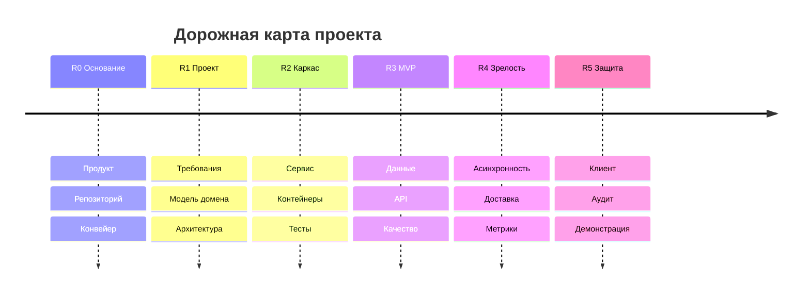
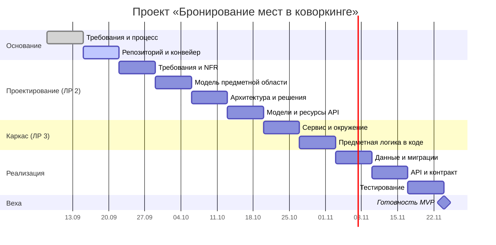

# Методические указания к лабораторным работам

Дисциплина «Технологии разработки программных систем» (ОмГТУ, 09.03.01).
ЛР 1 — модули 01, 02.

---

## Как пользоваться этим документом

Каждая лабораторная работа описана по одной схеме:

| Раздел | Зачем он вам |
|---|---|
| **Образ результата** | Что должно получиться. Прочитайте **первым** — дальше будет понятнее, зачем каждый шаг |
| **Что изучить** | Самодостаточный конспект теории. Искать в интернете не нужно: здесь есть всё, что требуется для выполнения |
| **Ход работы** | Пошаговая инструкция: что делать, как именно, что получится на выходе шага |
| **Структура артефактов** | Дерево файлов, которое должно получиться |
| **Критерии зачёта** | По этому списку принимается работа |
| **Типичные ошибки** | Чего не делать. Составлено по опыту прошлых потоков |
| **Как проходит приём** | Что будет на сдаче и какие вопросы зададут |

**Сквозной пример.** Через весь документ проходит один учебный проект — **«Бронирование рабочих мест в коворкинге»**. На нём показано, как выглядит каждый артефакт в готовом виде. Пример разбирается подробно, но **копировать его нельзя**: у вас будет свой домен, и преподаватель это проверит. Пример нужен, чтобы вы видели уровень детализации.

**Обозначения:**

- `команда` — вводится в терминале как есть
- *Курсив* — пояснение, а не то, что нужно набирать
- 🔶 — место, где студенты ошибаются чаще всего
- ⏱ — контрольная точка: здесь работа должна собираться и проходить проверки

**Как устроены работы курса.** Девять лабораторных работ, каждая собрана из одного-четырёх модулей и сдаёт один законченный результат. Работа из нескольких модулей делится на **части**, обозначенные буквой: «ЛР 2В» — часть В второй работы, «ЛР 2В, шаг 3» — третий шаг этой части. Разделы части нумеруются так же: «2В.1. Образ результата». Каждая часть принимается отдельно; работа зачтена, когда зачтены все её части.

| ЛР | Название | Модули | Части | Файл |
|---|---|---|---|---|
| 1 | Продукт, команда, репозиторий | М01, М02 | 1А продукт и процесс · 1Б репозиторий и конвейер | `lab-m01-m02.md` |
| 2 | Проектирование системы | М03 – М06 | 2А требования · 2Б предметная область · 2В решения · 2Г модели и ресурсы API | `lab-m03-m06.md` |
| 3 | Сервис и проектирование кода | М07, М08 | 3А сервис · 3Б предметная область в коде | `lab-m07-m08.md` |
| 4 | Данные и контракт API | М09, М10 | 4А данные · 4Б контракт API | `lab-m09-m11.md` |
| 5 | Инженерия качества | М11 | — | `lab-m09-m11.md` |
| 6 | Асинхронность и доставка | М12, М13 | 6А асинхронность · 6Б доставка | `lab-m12-m14.md` |
| 7 | Наблюдаемость и надёжность | М14 | — | `lab-m12-m14.md` |
| 8 | Клиентское приложение | М15 | — | `lab-m15-m17.md` |
| 9 | Анти-паттерны, разбор, защита | М16, М17 | 9А анти-паттерны · 9Б разбор и защита | `lab-m15-m17.md` |

**Ни одна работа не повторяет предыдущую.** Каждая строит на результате прошлой: истории с карты 1А становятся требованиями в 2А, агрегаты из 2Б — кодом в 3Б, модель данных из 2Г — миграцией в 4А, перечень ресурсов из 2Г — описанием OpenAPI в 4Б. Если в шаге написано «уточнить» — это правка существующего документа через запрос на слияние, а не новый документ.

---

# Лабораторная работа № 1. Продукт, команда, репозиторий

**Модули**: 01. Software Engineering и Agile · 02. Git, командная разработка и базовый CI
**Лекция**: Л1 «Инженерия ПО, процесс и команда»
**Команда**: 2–3 человека
**Кода в этой работе нет** — решения, документы и инфраструктура, в которой дальше будет вестись вся работа

| Часть | Модуль | Что получается |
|---|---|---|
| **1А** Запуск сквозного проекта | М01 | Предметная область, постановка проблемы, персоны, путь пользователя, карта пути клиента, карта историй с позвоночником MVP, границы охвата, дорожная карта, план семестра, определения готовности и завершённости, ритм команды |
| **1Б** Репозиторий, процесс и первый конвейер | М02 | Репозиторий с защищённой основной веткой, README, CONTRIBUTING, хуки, базовый конвейер, первый запрос на слияние с ревью; документы части 1А перенесены в репозиторий |

**Порядок.** Сначала 1А, затем 1Б: в шаге 4 части 1Б документы 1А переносятся в репозиторий вместе с его базовыми файлами.

**Чего здесь нет — и почему.** Истории на карте 1А — однострочные заголовки. Критерии приёмки, идентификаторы требований и приоритизация появляются в ЛР 2А, где истории становятся требованиями. Делать это здесь значило бы делать дважды.

---

## Часть 1А. Запуск сквозного проекта команды

**Модуль**: 01. Software Engineering и Agile
**Лекция**: Л1 «Инженерия ПО, процесс и команда»
**Команда**: 2–3 человека
**Кода в этой работе нет** — только решения и документы

---

### 1А.1. Образ результата

К моменту сдачи у вашей команды должна быть **папка с семью документами**, по которым посторонний человек за десять минут поймёт: что вы делаете, для кого, что войдёт в первую версию, чего вы сознательно не делаете, и как вы собираетесь работать.

```
docs/
├── requirements.md            Проблема, персоны, путь пользователя, MVP, границы
├── customer-journey-map.md    Карта пути клиента: боли и возможности
├── user-story-map.md          Карта историй: что строим и в каком порядке
├── roadmap.md                 Крупные вехи по семестру
├── gantt.md                   План по неделям с зависимостями
├── process.md                 Как работает команда: роли, ритм, DoR, DoD
└── CHANGELOG.md               Журнал изменений проекта
```

**Проверка «на постороннего».** Возьмите однокурсника из другой команды, дайте ему только эти файлы и попросите ответить на пять вопросов:

1. Какую проблему решает проект и у кого она?
2. Кто будет пользователем?
3. Что обязательно войдёт в первую версию?
4. Что команда решила не делать?
5. Когда что будет готово?

Если он ответил на все пять — работа готова. Если на каком-то вопросе он полез к вам за уточнением — соответствующий документ нужно дорабатывать.

🔶 **Главное заблуждение этой работы.** Кода нет — значит, «работа лёгкая, сделаем за вечер». Это не так. Решения, принятые здесь, определяют проект на четыре месяца: домен нельзя поменять в ноябре, когда к нему уже привязаны схема данных и половина кода. Отнеситесь к этой работе как к проектированию фундамента.

---

### 1А.2. Что изучить перед выполнением

Раздел самодостаточен. Если материал знаком — используйте как чек-лист; если что-то незнакомо — прочитайте подраздел. Дополнительные источники есть в конце модуля [m01-software-engineering-agile.md](./m01-software-engineering-agile.md), но для выполнения работы их читать не обязательно.

#### 1А.2.1. Разработка ПО как инженерная дисциплина

**Разработка программного обеспечения** (software engineering, SE) — инженерная дисциплина о создании программных систем, которые работают предсказуемо, поддерживаются и эволюционируют. Код — лишь один из артефактов, наряду с требованиями, архитектурой, тестами, документацией и процессами.

Три понятия, которые часто смешивают:

- **Программа** — код, решающий конкретную задачу. Одноразовая утилита, учебный пример, скрипт.
- **Программная система** — набор взаимодействующих программ, данных и инфраструктуры, организованных для решения класса задач. Имеет архитектуру, поддерживается, развивается.
- **Программный продукт** — система, ориентированная на пользователя: с поддержкой, обновлениями, документацией, лицензией. Продукт = система + всё, что вокруг неё для пользователя.

В курсе вы строите **программную систему**, обрастающую свойствами продукта.

**Почему «работает» недостаточно.** Код, работающий на машине разработчика, может ломаться у пользователя, через полгода, при росте нагрузки в десять раз, при отказе зависимости. Инженерия начинается там, где появляются вопросы: «а что будет, если…?», «а как мы узнаем, что сломалось?», «а как это безопасно изменить через год?».

#### 1А.2.2. Жизненный цикл разработки ПО

**Жизненный цикл разработки ПО** (software development lifecycle, SDLC) — модель фаз, которые проходит продукт от идеи до вывода из эксплуатации:

1. **Анализ требований** — что и для кого строим
2. **Проектирование** — как это будет устроено
3. **Реализация** — написание кода
4. **Тестирование** — проверка соответствия требованиям
5. **Внедрение** — развёртывание у пользователя
6. **Сопровождение** — исправление ошибок, развитие

В **каскадной** (waterfall) модели фазы идут строго последовательно. Это работает, когда требования зафиксированы и не могут меняться, а цена ошибки после выпуска крайне высока — медицина, транспорт, авиация. В типовой разработке каскад плох: требования уточняются по ходу, а ошибка в них обнаруживается на приёмке — в самый дорогой момент.

Поэтому доминируют **итеративные** (повторяющие проходы по фазам) и **инкрементальные** (каждая итерация добавляет работающий кусок) модели.

**Разница между ними, которую постоянно путают:**

- **Итеративная** — улучшаем целое. Каждый цикл даёт версию всей системы, но грубее. Аналогия: художник делает набросок всей картины, потом уточняет, потом детализирует.
- **Инкрементальная** — добавляем части. Каждый цикл даёт готовый кусок функциональности. Аналогия: дом строится по комнатам, каждая готова полностью.

На практике совмещают. Ваш сквозной проект устроен так же: модуль 08 переписывает код модуля 07 (итерация), модуль 09 добавляет работу с данными (инкремент).

#### 1А.2.3. Манифест гибких методологий

**Манифест гибких методологий** (Agile Manifesto, 2001) — документ на четыре страницы, с которого началось движение Agile. Четыре ценности:

1. **Люди и взаимодействие** важнее процессов и инструментов
2. **Работающий продукт** важнее исчерпывающей документации
3. **Сотрудничество с заказчиком** важнее согласования условий контракта
4. **Готовность к изменениям** важнее следования первоначальному плану

🔶 Ключевое слово — **«важнее», а не «вместо»**. Правая часть не отменяется. Самое распространённое искажение: «Agile — значит без документации». В манифесте написано «важнее **исчерпывающей** документации» — то есть избыточной, написанной ради процедуры. В нашем курсе документация требуется в каждом модуле, и манифесту это не противоречит: вся она работает, ею пользуются при разработке.

Двенадцать принципов раскрывают ценности практически: ранняя поставка, приветствие изменений, ровный темп работы, постоянное внимание к техническому совершенству, простота, самоорганизация команд.

Agile — это **не фреймворк**, а набор ценностей. Scrum, Kanban, XP, Shape Up — разные фреймворки, реализующие эти ценности по-разному.

#### 1А.2.4. Scrum

Работа делится на **спринты** фиксированной длины (1–4 недели), каждый даёт работающий инкремент.

**Роли:**

- **Владелец продукта** (Product Owner) — отвечает за то, **что** делается: формирует и приоритизирует бэклог, максимизирует ценность
- **Скрам-мастер** (Scrum Master) — отвечает за то, **как** делается: убирает препятствия, следит за процессом. Это **не** менеджер команды
- **Команда разработки** — сама решает, как достичь цели спринта

**Артефакты:**

- **Бэклог продукта** — упорядоченный по приоритету список всего, что когда-либо может понадобиться. Живой документ
- **Бэклог спринта** — задачи, взятые в текущий спринт, плюс план их выполнения
- **Инкремент** — сумма задач спринта, **готовая** к поставке. Именно готовая, а не «почти доделанная»

**События:**

- **Планирование спринта** — что войдёт в инкремент и как это будет сделано
- **Ежедневная встреча** — 15 минут: что сделал, что буду делать, что мешает
- **Обзор спринта** — показываем результат, собираем обратную связь
- **Ретроспектива** — чиним процесс: что работало, что мешало, что меняем

🔶 Самое частое искажение — ежедневная встреча превращается в отчёт перед руководителем. Это встреча **команды для команды**. Как только появляется человек, которому «докладывают», смысл теряется.

#### 1А.2.5. Kanban

Управление потоком вместо управления итерациями. Спринтов нет: задачи берутся из пула и двигаются по доске.

**Основные элементы:**

- **Доска** с колонками («Бэклог», «В работе», «На ревью», «Готово»). Колонки должны отражать **реальные** стадии работы, а не желаемые: если есть стадия «ждём ответа заказчика» — она должна быть на доске
- **Ограничение незавершённой работы** (work in progress limits, WIP-limits) — максимум карточек в колонке
- **Метрики потока:**
  - **Время выполнения** (lead time) — от создания задачи до завершения, включая ожидание в очереди. Это то, что чувствует заказчик
  - **Время цикла** (cycle time) — от начала работы до завершения. Это то, что чувствует команда

Разница между этими двумя величинами — сколько задача пролежала в очереди. Обычно она огромна и никем не замечается: задача делается два дня, а живёт в системе три недели.

**Почему ограничение незавершённой работы ускоряет работу.** Контринтуитивный момент: когда человек ведёт пять задач одновременно, он делает **меньше**, а не больше. Ни одна задача не доходит до конца, а переключение контекста съедает время — каждое возвращение требует заново вспомнить, что происходило. Аналогия: очередь в магазине. Если кассир начнёт обслуживать пятерых одновременно, каждый уйдёт позже.

**Кумулятивная диаграмма потока** (Cumulative Flow Diagram, CFD) — график, где по горизонтали время, по вертикали — количество задач в каждой колонке. Расширение полосы «в работе» означает избыток незавершённого, сужение полосы — узкое место, перед которым копится очередь.

#### 1А.2.6. XP и Shape Up

**Экстремальное программирование** (Extreme Programming, XP) — единственный подход, который говорит непосредственно об инженерных практиках, а не о процессе: парное программирование, разработка через тестирование, непрерывная интеграция, простой дизайн, рефакторинг, коллективное владение кодом. Именно из XP в отрасль пришли непрерывная интеграция и разработка через тестирование.

**Shape Up** (Basecamp) — шестинедельные циклы, «ставка» вместо плана, период охлаждения между циклами. Главная идея, полезная независимо от применения подхода: **срок и бюджет фиксированы почти всегда, гибким остаётся объём**. Умение договариваться об объёме — профессиональный навык.

**Как выбирать:**

| Ситуация | Подход |
|---|---|
| Стабильная команда, понятный объём, нужен предсказуемый ритм | Scrum |
| Непрерывный поток задач разного размера, поддержка | Kanban |
| Нужна инженерная дисциплина | Практики XP — добавляются к любому подходу |
| Небольшая команда, есть право резать объём | Shape Up |
| Команда из двух человек за одним столом | **Без фреймворка** — формализация создаст расходы без пользы |

🔶 Последняя строка не шутка. Студенты регулярно внедряют полный Scrum вдвоём и тонут в церемониях вместо работы. Облегчённый процесс допустим — но он должен быть **описан** в `process.md`.

#### 1А.2.7. Пользовательская история

**Пользовательская история** (user story) — описание функции с точки зрения пользователя:

> **Как** [роль], **я хочу** [что], **чтобы** [зачем].

🔶 Часть «чтобы» — самая важная и та, которую чаще всего пропускают. Без неё вы реализуете предложенное решение вместо того, чтобы решить задачу.

Пример: «Как менеджер, я хочу выгрузку в таблицу» → делаем выгрузку. «…чтобы посчитать сумму заказов за месяц» → возможно, выгрузка не нужна, достаточно показать сумму на экране. Часто более дешёвым способом.

На карте историй (шаг 7) история — **однострочный заголовок**: роль, действие, цель. Этого достаточно, чтобы разложить объём работ и выделить минимальный продукт.

**Чего здесь нет.** Критерии приёмки «дано — когда — тогда», идентификаторы и проверка по набору INVEST появляются в ЛР 2А: там история становится требованием, на которое ссылаются решения, тесты и код. Писать критерии сейчас значило бы писать их дважды — до того, как понятны стороны, ограничения и требования к качеству.

#### 1А.2.8. Путь пользователя и карта пути клиента

**Путь пользователя** (user journey) — последовательность шагов, которые пользователь совершает для достижения цели. Например: «открыть приложение → выбрать дату → посмотреть свободные места → выбрать место → подтвердить → получить подтверждение».

**Карта пути клиента** (Customer Journey Map, CJM) — тот же путь плюс дополнительные слои:

| Слой | Что означает |
|---|---|
| **Этапы** | Крупные шаги пути |
| **Действия** | Что конкретно делает пользователь |
| **Мысли** | О чём думает в этот момент |
| **Эмоции** | Что чувствует: растерянность, раздражение, облегчение |
| **Точки контакта** | Где взаимодействует с продуктом: сайт, письмо, уведомление, поддержка |
| **Болевые точки** | Где возникают проблемы |
| **Возможности** | Где можно улучшить опыт |

**Зачем нужны обе техники.** Путь пользователя показывает, **что** делает человек. Карта показывает, **почему** и **как он себя чувствует**. Без второго вы оптимизируете шаги, не понимая, что на самом деле мешает.

Ценность сосредоточена в столбце «болевые точки»: **это готовый список задач, отсортированный по значимости для пользователя**. Из карты напрямую получается бэклог.

Карта строится **для каждой персоны отдельно** — один продукт для разных ролей имеет разные пути и разные боли.

#### 1А.2.9. Карта пользовательских историй

**Карта пользовательских историй** (User Story Mapping, Джефф Паттон) — техника визуальной декомпозиции объёма в план поставки. Строится слева направо:

1. **Позвоночник** (spine) — пользовательские активности в порядке естественного выполнения. Верхний ряд карточек
2. **Задачи** — под каждой активностью то, что пользователь решает на этом шаге. Второй ряд
3. **Истории** — под каждой задачей истории, которые её решают. Третий ряд, самый длинный

После построения проводится горизонтальная линия, отделяющая **минимально жизнеспособный продукт** — истории, без которых сквозной сценарий не работает, — от того, что можно отложить. Следующие горизонтальные слои — следующие релизы.

**Чем это лучше списка задач.** В обычном списке всё выглядит одинаково важным, не видно, что получится в первой версии, не видно пропусков в сценарии, и заказчику невозможно объяснить. В карте приоритет виден пространственно, минимальный путь читается одной строкой, пробелы в сценарии заметны сразу.

#### 1А.2.10. MVP, границы объёма и вертикальные срезы

**Минимально жизнеспособный продукт** (Minimum Viable Product, MVP) — минимальный набор функций, позволяющий получить обратную связь от реальных пользователей. Не «самая дешёвая версия», а **самая маленькая полезная**.

**Вне области охвата** (out-of-scope) — явный список того, что **не** делается. Зачем фиксировать письменно:

- защищает от постоянного расползания объёма
- даёт честную картину ожиданий
- помогает потом вернуться и переприоритизировать

🔶 **Решение «мы это не делаем» нужно записать так же явно, как решение «делаем».** Иначе через месяц кто-нибудь начнёт это делать — и будет прав, потому что нигде не написано, что не надо.

**Вертикальные и горизонтальные срезы.** Это самая дорогая ошибка планирования:

| Горизонтальный срез — так не надо | Вертикальный срез — так надо |
|---|---|
| Неделя 1: вся база данных | Неделя 1: один сценарий целиком — БД, сервер, интерфейс |
| Неделя 2: весь слой API | Неделя 2: второй сценарий целиком |
| Неделя 3: весь интерфейс | |
| Результат только в конце, показать нечего | Каждую неделю есть что показать |
| Ошибка в требованиях всплывает на третьей неделе | Обратная связь приходит рано и дёшево |

**Правило проверки**: срез вертикален, если после него пользователь может выполнить осмысленное действие **целиком**.

#### 1А.2.11. Определения готовности и завершённости

**Определение готовности** (Definition of Ready, DoR) — чек-лист, которому должна соответствовать задача, **чтобы её можно было взять в работу**:

- есть описание и критерии приёмки
- понятно, что считается результатом
- зависимости известны, внешних блокировок нет
- задача помещается в один цикл
- команда её оценила

**Определение завершённости** (Definition of Done, DoD) — чек-лист, чтобы задача считалась **сделанной**:

- код прошёл ревью
- тесты написаны и проходят в конвейере
- документация обновлена
- запись добавлена в журнал изменений
- изменение развёрнуто в тестовой среде

**Зачем нужны оба.** DoR защищает команду от «взяли непонятную задачу и три дня уточняли». DoD защищает от «закрыли задачу, а потом оказалось, что ничего не работает и не задокументировано».

🔶 **Требование курса**: ваше определение завершённости **обязано** содержать пункты про тесты, ревью и документацию. Иначе артефакты последующих модулей будут приниматься формально.

**Критерий качества формулировки**: по вашему определению работу должен быть способен принять человек, **не участвовавший в её обсуждении**. «Задача понятна» и «работает» этому критерию не удовлетворяют.

#### 1А.2.12. Порядок работ

Порядок работ в этой части задаёт **позвоночник MVP** на карте историй: сначала то, без чего сквозной путь не проходит, затем слои следующих выпусков. Этого достаточно для дорожной карты и плана семестра.

Приоритизация как метод — MoSCoW, RICE, матрица ценности и трудоёмкости — применяется к **требованиям** и разбирается в ЛР 2А.

#### 1А.2.13. Оценка задач и её систематические ошибки

**Задача оценки — не угадать срок**, а выявить разное понимание задачи внутри команды до того, как её начали делать.

Если два человека оценили одну задачу в 1 и в 8 — ценность не в среднем значении, а в разговоре, который за этим последует. Почти всегда выясняется, что они поняли задачу по-разному: один думал про минимальную реализацию, другой — про обработку всех ошибок и тесты.

**Техники:**

- **Покер планирования** (planning poker) — все оценивают одновременно и вскрывают карты вместе, расхождение обсуждают. Одновременность защищает от эффекта якорения
- **Очки историй** (story points, SP) — относительный размер, а не часы. Человек плохо оценивает абсолютное время и хорошо сравнивает «больше/меньше»
- **Размер футболки** (S / M / L) — для крупных тем, где точность бессмысленна
- **Подход без оценок** — резать работу до одинаково мелких кусков и считать их количество

**Систематические ошибки**, работающие против вас всегда:

| Ошибка | В чём состоит |
|---|---|
| **Ошибка планирования** | Мы оцениваем идеальный ход работ: без прерываний, проблем, отладки и правок по ревью |
| **Эффект якорения** | Первая названная цифра тянет за собой остальные независимо от задачи |
| **Ошибка невозвратных затрат** | «Уже вложено — надо доделать». Вложенное время потрачено в любом случае; решать нужно по будущим затратам |
| **Оптимизм на расстоянии** | Чужая задача всегда кажется простой. И своя на следующий месяц — тоже |

Это не недостаток опыта, а устойчивые особенности мышления: победить нельзя, учитывать можно.

#### 1А.2.14. Планирование: дорожная карта и диаграмма Ганта

Три горизонта — три инструмента и три аудитории:

| Инструмент | Горизонт | Для кого | Роль |
|---|---|---|---|
| **Дорожная карта** | Квартал, семестр | Заказчик, руководство | Крупные темы без точных дат |
| **Диаграмма Ганта** | Весь проект | Заинтересованные стороны | Задачи, зависимости, вехи. Инструмент коммуникации, **не** исполнения |
| **Планирование цикла** | Одна итерация | Команда | Конкретные задачи. Механизм исполнения |

**Когда Гантт вреден**: этап исследования, неизвестный объём, частые изменения — вы потратите больше времени на перерисовку, чем на работу.

**Два способа планирования:**

- **От цели** — обратный отсчёт от срока: «через четыре месяца защита, что минимально должно работать?». Создаёт давление
- **От скорости** — прямой отсчёт от темпа: «при текущем темпе мы успеем вот это». Даёт реалистичность

🔶 Инженер обязан уметь оба и **честно называть, каким пользуется**. Подмена — когда план построен от цели, а выдаётся за оценку от скорости — источник большинства сорванных сроков.

**Буфер на неопределённость.** Закладывать запас нужно всегда, но не размазывать по каждой задаче — так он расходуется незаметно (работает закон Паркинсона: работа занимает всё отведённое время). Лучше один явный общий буфер 20–30 %, который видно и расход которого обсуждается.

#### 1А.2.15. Метрики команды

| Метрика | Что означает |
|---|---|
| **Скорость** (velocity) | Сколько команда фактически завершила за цикл. Факт прошлого, не план и не обязательство |
| **Мощность** (capacity) | Сколько команда способна сделать с учётом встреч, ревью, переключений. Верхняя граница |
| **Производительность** (throughput) | Количество завершённых задач за период, без учёта размера |
| **Время выполнения** (lead time) | От появления задачи до завершения — что чувствует заказчик |
| **Время цикла** (cycle time) | От начала работы до завершения — что чувствует команда |
| **Time-to-market** | От идеи до пользователя. Единственная метрика, которая волнует бизнес |
| **Метрики DORA** | Частота развёртываний, время до изменения, доля неудачных изменений, время восстановления. Подробно — в модуле 14 |

🔶 **Закон Гудхарта: как только метрика становится целью, она перестаёт быть хорошей метрикой.** Потребовали роста скорости — команда завысила оценки: число выросло, работы столько же. Метрики — диагностический инструмент: по ним меняют процесс, а не само число.

#### 1А.2.16. Графики процесса

| График | Что показывает | Ограничение |
|---|---|---|
| **Диаграмма сгорания** | Остаток работы против идеальной линии | Рост объёма выглядит как отставание — не различить |
| **Диаграмма нарастания** | Выполненный объём плюс отдельная линия общего объёма | Рост объёма виден явно. Предпочтительнее |
| **Кумулятивная диаграмма потока** | Распределение задач по стадиям во времени | Требует дисциплины в ведении доски |
| **Температурный график** | Отклонения по срокам и стоимости, зоны здоровья проекта | Требует учёта трудозатрат |

Практическое наблюдение: если диаграмма сгорания весь цикл идёт горизонтально, а в последний день падает вертикально — это не итерация, а мини-каскад. Всё сделали в конце, обратной связи не было.

#### 1А.2.17. Технический долг

**Технический долг** — не дефект и не плохой код, а **осознанно принятое упрощение**, которое ускоряет сегодня и замедляет завтра.

Ключевое слово — «осознанно». Долг допустим, если он **записан** и у него есть срок возврата. Незаписанный долг перестаёт быть долгом и становится просто плохой системой: через полгода никто не помнит, что здесь было упрощение, а не задумка.

Причины возникновения: давление сроков, отсутствие знания на момент решения, эволюция требований, отсутствие дисциплины (нет определения завершённости, нет ревью).

Как выплачивать: заложить в определение завершённости, выделять долю цикла (10–20 %), платить мелкие долги сразу.

#### 1А.2.18. Лицензии свободного ПО

Когда вы используете чужой код, вы вступаете в юридические отношения с автором — их регулирует лицензия.

| Лицензия | Что можно | Что обязаны |
|---|---|---|
| **MIT, BSD** | Почти всё, включая использование в закрытом продукте | Сохранить текст лицензии и упоминание автора |
| **Apache 2.0** | То же плюс защита от патентных претензий автора | Сохранить лицензию, отмечать изменённые файлы |
| **LGPL** | Связываться с закрытым кодом динамически | Открыть изменения самой библиотеки |
| **GPL** | Использовать в открытом проекте | Открыть исходники производной работы на тех же условиях |
| **AGPL** | То же, что GPL | Плюс: доступ через сеть считается распространением — критично для веб-сервисов |
| **Без лицензии** | **Ничего** | Запросить разрешение автора или не использовать |

🔶 Самая частая ошибка: «выложено в открытом доступе — значит можно брать». **Отсутствие лицензии означает «все права защищены»**, а не «делайте что хотите».

---

### 1А.3. Ход работы

Четырнадцать шагов. Выполняются командой; каждый шаг заканчивается конкретным текстом в конкретном файле.

#### Шаг 1. Сформировать команду и распределить ответственность

**Что сделать.** Собрать команду из 2–3 человек. Состав фиксируется и не меняется до конца курса.

**Как именно.** Распределите **функциональные зоны ответственности** — не роли Scrum, а «кто за чем следит». Один человек может отвечать за несколько зон; зон должно быть покрыто четыре:

| Зона | За что отвечает |
|---|---|
| Требования и продукт | Чтобы документы требований были актуальны и решения зафиксированы |
| Репозиторий и процесс | Чтобы правила работы соблюдались и репозиторий был в порядке |
| Качество | Чтобы определение завершённости выполнялось, тесты не отключались |
| Инфраструктура | Чтобы окружение и конвейер работали у всех |

🔶 Ответственный за зону **не делает всю работу в этой зоне сам** — он следит, что она сделана. Код и документы пишут все.

**Результат шага.** В `docs/process.md` появился раздел:

```markdown
## Команда

| Участник | Зоны ответственности | Контакт |
|---|---|---|
| Иванов И. | Требования и продукт, Качество | @ivanov |
| Петров П. | Репозиторий и процесс, Инфраструктура | @petrov |

Состав зафиксирован 05.09.2026 и не меняется до конца курса.
```

#### Шаг 2. Выбрать предметную область

**Что сделать.** Выбрать домен из каталога в [project.md](./project.md) или предложить свой — и **доказать**, что он проходит по четырём требованиям.

**Как именно.** Возьмите **два-три** кандидата, не один: первый часто не проходит. Для каждого заполните таблицу проверки.

**Четыре требования:**

1. Минимум два-три **ограниченных контекста** — разных смысловых области. Каталог и доставка — разные. Список дел — одна
2. Есть **внешняя интеграция** — платежи, карты, уведомления, парсинг, устройства
3. Есть **осмысленный пользовательский интерфейс** — клиентская часть обязательна, и ей должно быть что показывать
4. **Нетривиальные данные** — не одна таблица: связи, состояния, история

**Пример проверки (сквозной пример курса):**

```markdown
### Кандидат 1: Бронирование рабочих мест в коворкинге

| Требование | Проверка | Итог |
|---|---|---|
| 2–3 ограниченных контекста | Площадки и места · Бронирования · Тарифы и оплата · Уведомления | ✅ четыре |
| Внешняя интеграция | Платёжный шлюз, отправка уведомлений, календарь | ✅ |
| Пользовательский интерфейс | Экран выбора даты и места, мои брони, админка площадки | ✅ |
| Нетривиальные данные | Места, брони, статусы, история изменений, тарифы по времени | ✅ связи и история |

**Вывод**: домен проходит.
```

**Что не подойдёт и почему:**

| Не подойдёт | Причина |
|---|---|
| Игровое приложение | Нет предметной области для моделирования, нет интеграций, нечего проектировать в данных |
| Чат-бот как весь проект | Бот — канал взаимодействия, а не система. Нет клиентской части, обычно один контекст |
| Список задач, калькулятор | Один контекст, одна таблица. Нечего проектировать |
| Клон сервиса без своей логики | Пропадает этап требований: решение известно заранее |

**Результат шага.** В `docs/requirements.md` — раздел «Предметная область» с таблицей проверки по четырём требованиям и итоговым выбором. Домен **утверждается преподавателем**.

#### Шаг 3. Сформулировать постановку проблемы

**Что сделать.** Написать, какую проблему решает проект.

**Как именно.** Четыре обязательных элемента. Заполните шаблон:

```markdown
## Постановка проблемы

**Что**: <какую проблему решаем — одно-два предложения>

**Для кого**: <кто страдает от этой проблемы, конкретно>

**Зачем**: <что изменится, если решим>

**Как измерим успех**: <наблюдаемый признак, по которому поймём, что стало лучше>
```

🔶 Последний пункт обязателен и проваливается чаще всего. «Сделать удобный сервис» измеримым не является. Измеримое — это то, что можно наблюдать: доля, время, количество.

**Пример:**

```markdown
## Постановка проблемы

**Что**: Администратор коворкинга ведёт брони в таблице и по телефону.
Из-за этого случаются двойные брони одного места, а посетитель узнаёт
о конфликте только на месте.

**Для кого**: Администраторы небольших коворкингов (до 60 мест, один-два
администратора) и их постоянные посетители.

**Зачем**: Посетитель бронирует сам и видит актуальную занятость;
администратор перестаёт быть узким местом.

**Как измерим успех**: Доля броней, оформленных без участия администратора,
и количество конфликтов «место занято» за месяц.
```

**Типичные ошибки на этом шаге:**

| Ошибка | Пример | Как исправить |
|---|---|---|
| Описано решение, а не проблема | «Нужен сервис с базой и API» | Спросите: а какая проблема без этого остаётся? |
| «Для кого» — слишком широко | «Для всех пользователей» | Назовите конкретную роль и условия |
| Нет измеримого признака | «Станет удобнее» | Что вы сможете посчитать? |

**Результат шага.** Раздел «Постановка проблемы» в `docs/requirements.md`, четыре абзаца.

#### Шаг 4. Описать персоны

**Что сделать.** Описать 2–3 типичных пользователя.

**Как именно.** Персона — это не демография, а **поведение и боли**. Заполните на каждую:

```markdown
### Персона: <короткое имя роли>

**Роль и контекст**: <кто это, в какой ситуации пользуется системой>
**Цель**: <чего хочет добиться>
**Как решает задачу сейчас**: <без вашей системы>
**Боли**: <что конкретно мешает — список>
**Что для него важно в решении**: <критерии выбора>
```

🔶 **Проверка качества: если из персоны не следует ни одного требования — она написана зря.**

**Пример:**

```markdown
### Персона: Постоянный посетитель

**Роль и контекст**: Работает удалённо, приходит в коворкинг 3–4 раза
в неделю, обычно в одно и то же время. Привык к конкретному месту у окна.

**Цель**: Прийти и сесть за привычное место, не выясняя заранее,
свободно ли оно.

**Как решает задачу сейчас**: Пишет администратору в мессенджер накануне
вечером. Ответ приходит утром, иногда не приходит.

**Боли**:
- Не видит занятость заранее — узнаёт только из ответа администратора
- Если место занято, узнаёт об этом поздно и меняет планы
- Нельзя отменить бронь быстро — надо снова писать

**Что важно**: увидеть занятость на нужную дату за несколько секунд;
отменить бронь в один шаг.
```

```markdown
### Персона: Администратор площадки

**Роль и контекст**: Один человек на площадку. Параллельно принимает
посетителей, отвечает на сообщения и ведёт таблицу броней.

**Цель**: Не быть узким местом и не разбирать конфликты на месте.

**Как решает задачу сейчас**: Таблица в облаке плюс переписка
в мессенджере. Синхронизирует вручную.

**Боли**:
- Двойные брони: записал в таблицу, забыл отметить отмену
- Отвлекают на каждый вопрос «свободно ли место»
- Не видит, какие места простаивают

**Что важно**: видеть занятость целиком; чтобы посетитель бронировал сам.
```

**Результат шага.** 2–3 персоны в `docs/requirements.md`. Из каждой должно следовать хотя бы одно требование.

#### Шаг 5. Построить путь пользователя

**Что сделать.** Описать сквозной путь для ключевого сценария: 5–7 шагов.

**Как именно.** Выберите **один** сценарий — тот, ради которого система существует. Опишите шаги от возникновения потребности до получения результата. Диаграмму можно сделать в Mermaid прямо в Markdown — она отрисуется на платформе репозитория.

**Пример:**

````markdown
## Путь пользователя: бронирование места

Персона: Постоянный посетитель
Сценарий: забронировать место на завтра


1. **Понял, что нужно место** — вечером планирует завтрашний день
2. **Открыл приложение** — с телефона
3. **Выбрал дату** — по умолчанию завтра
4. **Увидел свободные места** — что свободно и что занято на эту дату
5. **Выбрал место** — привычное у окна
6. **Подтвердил** — один шаг, без ввода данных
7. **Получил подтверждение** — номер места, время, кнопка отмены
````

**Результат шага.** Раздел «Путь пользователя» в `docs/requirements.md`: диаграмма плюс нумерованное описание шагов.

#### Шаг 6. Построить карту пути клиента

**Что сделать.** Расширить путь пользователя до карты — добавить мысли, эмоции, точки контакта, боли и возможности. **Для каждой персоны отдельно.**

**Как именно.** Удобнее всего таблицей: строки — слои, столбцы — этапы. Если делаете в Miro или FigJam — экспортируйте в PNG и положите рядом с текстовым описанием: файл в репозитории должен быть читаем без доступа к внешнему сервису.

**Шаблон:**

```markdown
## Карта пути клиента: <персона>

| Слой | Этап 1 | Этап 2 | Этап 3 | ... |
|---|---|---|---|---|
| **Действие** | | | | |
| **Мысль** | | | | |
| **Эмоция** | | | | |
| **Точка контакта** | | | | |
| **Боль** | | | | |
| **Возможность** | | | | |
```

**Пример:**

```markdown
## Карта пути клиента: Постоянный посетитель

| Слой | Планирование | Проверка занятости | Бронирование | Приход | Отмена |
|---|---|---|---|---|---|
| **Действие** | Решает, что завтра нужно место | Пишет администратору | Ждёт ответа | Приходит, садится | Пишет об отмене |
| **Мысль** | «Надо бы заранее» | «Свободно ли моё место?» | «Ответят до утра?» | «Точно ли за мной?» | «Успею предупредить?» |
| **Эмоция** | Спокойствие | Лёгкая тревога | Раздражение от ожидания | Облегчение или досада | Неловкость |
| **Точка контакта** | — | Мессенджер | Мессенджер | Стойка администратора | Мессенджер |
| **Боль** | — | Нельзя посмотреть самому | Ответ приходит утром или не приходит | Иногда место занято | Отмена только через человека |
| **Возможность** | Напоминание накануне | Схема занятости в приложении | Мгновенное подтверждение | Бронь видна на месте | Отмена в один шаг |
```

🔶 Строка «Боль» — это и есть ваш будущий бэклог, уже отсортированный по значимости для пользователя. Не пропускайте её.

**Результат шага.** `docs/customer-journey-map.md`: карта на каждую персону плюс краткий вывод «какие три боли самые дорогие».

#### Шаг 7. Провести картирование пользовательских историй

**Что сделать.** Разложить объём работ на карту: активности → задачи → истории. Выделить минимальный сквозной путь.

**Как именно.**

1. Возьмите стикеры или доску в Miro/FigJam. Верхний ряд — **активности** пользователя слева направо в порядке выполнения
2. Под каждой активностью — **задачи**, которые пользователь решает на этом шаге
3. Под каждой задачей — **истории** в формате «Как… я хочу… чтобы…»
4. Проведите горизонтальную линию под минимальным набором историй, при котором сквозной путь работает. Это **позвоночник** — ваш минимально жизнеспособный продукт
5. Ниже линии — слои следующих релизов

**Пример (текстовое представление для репозитория):**

```markdown
## Карта пользовательских историй

### Активности (позвоночник пути)

| Найти место | Забронировать | Прийти | Управлять бронью |
|---|---|---|---|

### Полная карта

**Активность: Найти место**
- Задача: посмотреть занятость на дату
  - MVP · Как посетитель, я хочу видеть свободные места на выбранную дату, чтобы выбрать подходящее
  - v1.1 · Как посетитель, я хочу фильтр «только у окна», чтобы не искать глазами
  - v1.2 · Как посетитель, я хочу видеть занятость на неделю вперёд

**Активность: Забронировать**
- Задача: закрепить за собой место
  - MVP · Как посетитель, я хочу забронировать свободное место на дату, чтобы быть уверенным
  - MVP · Как посетитель, я хочу получить подтверждение с номером места
  - v1.1 · Как посетитель, я хочу повторить вчерашнюю бронь в один шаг

**Активность: Прийти**
- Задача: подтвердить присутствие
  - MVP · Как администратор, я хочу видеть список броней на сегодня
  - v1.2 · Как посетитель, я хочу отметиться по QR-коду

**Активность: Управлять бронью**
- Задача: отменить или перенести
  - MVP · Как посетитель, я хочу отменить свою бронь, чтобы место освободилось
  - v1.1 · Как посетитель, я хочу перенести бронь на другую дату

### Позвоночник MVP

Посмотреть занятость → забронировать → получить подтверждение →
администратор видит список → отменить бронь.

Это минимальный сквозной путь: убрав любой шаг, получим неработающий сценарий.
```

🔶 Проверка: **позвоночник должен читаться одной строкой как связный сценарий**. Если читается как набор несвязанных функций — вы построили список задач, а не карту.

**Результат шага.** `docs/user-story-map.md` с полной картой, выделенным позвоночником и слоями релизов. Если делали на доске — плюс экспорт в PNG.

#### Шаг 8. Зафиксировать MVP и границы объёма

**Что сделать.** Явно записать, что входит в первую версию и что не делается.

**Как именно.** Два списка рядом. Для каждого пункта «не делаем» — **причина**.

**Пример:**

```markdown
## Минимально жизнеспособный продукт

Входит:
- Просмотр свободных мест на выбранную дату
- Бронирование свободного места
- Подтверждение с номером места и временем
- Список броней на сегодня для администратора
- Отмена собственной брони

Критерий: посетитель может пройти сценарий «нашёл — забронировал —
пришёл — отменил» без участия администратора.

## Вне области охвата этого семестра

| Не делаем | Почему |
|---|---|
| Онлайн-оплата | Требует договора с платёжным шлюзом; для проверки гипотезы не нужна |
| Мобильное приложение | Веб-версия закрывает сценарий; нативный клиент — отдельный объём |
| Несколько площадок | Усложняет модель данных, не влияет на проверяемую гипотезу |
| Абонементы и тарифы | Ценообразование — отдельная предметная область |
| Интеграция с календарём | Удобство, а не необходимость |
```

**Результат шага.** Разделы «MVP» и «Вне области охвата» в `docs/requirements.md`.

#### Шаг 9. Построить дорожную карту

**Что сделать.** Разложить работу на крупные вехи по семестру.

**Как именно.** Привяжите вехи к модулям курса — так план будет реалистичным. Без точных дат внутри вехи.

**Пример:**

````markdown
## Дорожная карта

| Веха | Модули | Что будет готово |
|---|---|---|
| **R0. Основание** | М01–М02 | Продукт и процесс, репозиторий, конвейер проверок |
| **R1. Проект** | М03–М06 | Требования, включая нефункциональные (non-functional requirements, NFR), модель предметной области, архитектурные решения, диаграммы, перечень ресурсов API |
| **R2. Каркас** | М07–М08 | Работающий сервис, окружение в контейнерах, предметная логика в коде, первые тесты |
| **R3. MVP** | М09–М11 | Данные, API, стратегия тестирования |
| **R4. Зрелость** | М12–М14 | Асинхронный сценарий, доставка, наблюдаемость |
| **R5. Защита** | М15–М17 | Клиентское приложение, аудит, архитектурный обзор |


````

**Результат шага.** `docs/roadmap.md`.

#### Шаг 10. Построить диаграмму Ганта

**Что сделать.** Разложить семестр по неделям с зависимостями и контрольными точками.

**Как именно.** Mermaid умеет строить диаграммы Ганта прямо в Markdown — внешний инструмент не нужен. Синтаксис: раздел, название задачи, идентификатор, дата начала, длительность. Зависимость задаётся через `after`.

**Пример:**

````markdown
## План семестра



**Контрольные точки:**

| Точка | Срок | Критерий прохождения |
|---|---|---|
| Требования утверждены | конец М01 | Домен согласован, MVP зафиксирован |
| Конвейер зелёный | конец М02 | Ветка защищена, проверки проходят |
| Проект системы принят | конец М06 | ЛР 2 зачтена: требования, модель, решения, диаграммы, перечень ресурсов |
| Сервис поднимается | конец М07 | Одна команда — работающее окружение |
| MVP работает | конец М11 | Сквозной сценарий проходится целиком |

**Буфер**: 20 % времени каждой вехи заложено на непредвиденное. Расход буфера
фиксируется в журнале изменений.
````

🔶 Не пытайтесь расписать все семнадцать модулей по дням. Гантт — инструмент коммуникации: он показывает порядок и зависимости, а не является обязательством по каждой задаче.

**Результат шага.** `docs/gantt.md` с диаграммой, таблицей контрольных точек и явно указанным буфером.

#### Шаг 11. Сформулировать определения готовности и завершённости

**Что сделать.** Написать два чек-листа **под свой проект**.

**Как именно.** Не копируйте шаблон из интернета: generic-вариант содержит лишнее и пропускает важное. Отталкивайтесь от вопроса «что у нас пойдёт не так, если этого пункта не будет».

🔶 **Требование курса**: определение завершённости обязано содержать пункты про тесты, ревью и документацию.

**Пример:**

```markdown
## Определение готовности

Задачу можно брать в работу, если:

- [ ] Есть критерии приёмки в формате Дано — Когда — Тогда
- [ ] Указано, какой истории из карты она соответствует
- [ ] Понятно, каким изменением в интерфейсе или API она проявится
- [ ] Нет незакрытых вопросов к формулировке
- [ ] Задача помещается в одну неделю; если нет — разбита

## Определение завершённости

Задача считается сделанной, если:

- [ ] Код влит в основную ветку через запрос на слияние
- [ ] Запрос прошёл ревью второго участника с содержательными комментариями
- [ ] Конвейер проверок зелёный
- [ ] Написаны тесты на критерии приёмки, они проходят
- [ ] Документация обновлена: README или соответствующий файл в docs/
- [ ] Добавлена запись в CHANGELOG.md
- [ ] Изменение проверено на чистом окружении (не только «у меня работает»)
```

**Проверка формулировки:** по вашему определению работу должен быть способен принять человек, не участвовавший в её обсуждении. Прогоните каждый пункт через вопрос «можно ли это проверить, не спрашивая автора?».

**Результат шага.** Разделы в `docs/process.md`.

#### Шаг 12. Настроить ритм команды

**Что сделать.** Договориться, когда и как вы синхронизируетесь.

**Как именно.** Зафиксируйте три вещи: когда встречаетесь, где ведёте задачи, как принимаете решения.

**Пример:**

```markdown
## Ритм команды

| Событие | Когда | Длительность | Формат |
|---|---|---|---|
| Синхронизация | Пн, Чт, 19:00 | 15 мин | Голосом: что сделал, что буду, что мешает |
| Планирование недели | Пн, после синхронизации | 30 мин | Разбор задач на неделю из бэклога |
| Ретроспектива | Каждый второй Пт | 30 мин | Что работало, что мешало, одно изменение на следующие две недели |

## Как принимаем решения

- Решения по продукту и архитектуре — обсуждаем, фиксируем письменно
- При разногласии: если не договорились за 15 минут, выносим преподавателю
- Любое решение, которое трудно откатить, записывается — с модуля 05
  в формате архитектурного решения

## Инструменты

| Назначение | Инструмент |
|---|---|
| Бэклог и задачи | GitHub Projects |
| Визуализация карт | Miro (экспорт в PNG в репозиторий) |
| Документация | Markdown в docs/ |
| Связь | Общий чат |
```

🔶 Не берите полный набор церемоний Scrum, если вас двое. Опишите тот процесс, который действительно будете соблюдать.

**Результат шага.** Разделы в `docs/process.md`.

#### Шаг 13. Выбрать инструменты

**Что сделать.** Определиться, где ведёте задачи, где рисуете карты, где храните документы.

**Как именно.** Требование одно: **документы живут в Markdown**, чтобы в модуле 02 переехать в репозиторий без переделки. Визуальные артефакты (карты из Miro) экспортируются в PNG и кладутся рядом с текстовым описанием — файл должен быть читаем без доступа к внешнему сервису.

| Назначение | Варианты | Требование |
|---|---|---|
| Бэклог | GitHub Projects, Kaiten, YouTrack, доска в Miro | Доступ у всех участников |
| Карты (CJM, USM) | Miro, FigJam, Excalidraw, обычная таблица в Markdown | Экспорт в PNG обязателен |
| Диаграммы | Mermaid прямо в Markdown | Предпочтительно: версионируется вместе с текстом |
| Документы | Markdown | Обязательно |

**Результат шага.** Таблица инструментов в `docs/process.md`.

#### Шаг 14. Начать журнал изменений

**Что сделать.** Завести `CHANGELOG.md` и сделать первую запись.

**Как именно.** Используйте формат Keep a Changelog: версии сверху вниз, внутри версии — группы изменений. Группы: Added (добавлено), Changed (изменено), Deprecated (устарело), Removed (удалено), Fixed (исправлено), Security (безопасность).

**Пример:**

```markdown
# Журнал изменений

Формат: [Keep a Changelog](https://keepachangelog.com/ru/1.1.0/).

## [Не выпущено]

### Добавлено
- Постановка проблемы, персоны, путь пользователя
- Карта пути клиента для обеих персон
- Карта пользовательских историй с выделенным MVP
- Дорожная карта и план семестра
- Определения готовности и завершённости, ритм команды

## [0.1.0] — 2026-09-12

Базовое состояние проекта.

### Добавлено
- Команда сформирована, зоны ответственности распределены
- Предметная область выбрана и проверена по четырём требованиям
```

**Результат шага.** `docs/CHANGELOG.md` с первой записью. В ЛР 1Б он переедет в репозиторий вместе с остальными документами и останется в `docs/`.

---

### 1А.4. Структура артефактов

К сдаче должно получиться:

```
docs/
├── requirements.md
│   ├── Предметная область (с таблицей проверки)
│   ├── Постановка проблемы (что / для кого / зачем / как измерим)
│   ├── Персоны (2–3)
│   ├── Путь пользователя (диаграмма + шаги)
│   ├── Минимально жизнеспособный продукт
│   └── Вне области охвата (с причинами)
├── customer-journey-map.md
│   ├── Карта на каждую персону
│   └── Вывод: три самые дорогие боли
├── user-story-map.md
│   ├── Активности → задачи → истории
│   ├── Позвоночник MVP
│   └── Слои релизов
├── roadmap.md
├── gantt.md
│   ├── Диаграмма
│   ├── Контрольные точки
│   └── Буфер
├── process.md
│   ├── Команда и зоны ответственности
│   ├── Определение готовности
│   ├── Определение завершённости
│   ├── Ритм команды
│   ├── Как принимаем решения
│   └── Инструменты
└── CHANGELOG.md
```

---

### 1А.5. Критерии зачёта

- [ ] Команда оформлена, зоны ответственности распределены и записаны
- [ ] Домен выбран и **проверен по четырём требованиям** в виде таблицы
- [ ] Постановка проблемы содержит все четыре элемента, включая **измеримый** признак успеха
- [ ] Есть 2–3 персоны; из каждой следует хотя бы одно требование
- [ ] Есть путь пользователя на 5–7 шагов для ключевого сценария
- [ ] Есть карта пути клиента **на каждую персону** с болями и возможностями
- [ ] Проведено картирование историй: видны активности, задачи, истории
- [ ] **Позвоночник MVP выделен и читается как связный сценарий**
- [ ] MVP и границы объёма зафиксированы, у каждого «не делаем» указана причина
- [ ] Есть дорожная карта с вехами, привязанными к модулям
- [ ] Есть диаграмма Ганта с зависимостями, контрольными точками и явным буфером
- [ ] Истории на карте — однострочные; критерии приёмки и приоритеты не пишутся (это ЛР 2А)
- [ ] Определения готовности и завершённости написаны **под проект**, проходят проверку «принять без автора»
- [ ] Определение завершённости содержит пункты про тесты, ревью и документацию
- [ ] Ритм команды и инструменты зафиксированы
- [ ] Журнал изменений начат в формате Keep a Changelog
- [ ] Команда за три минуты устно отвечает: что делаем, для кого, что в MVP, чего не делаем, как доставим по семестру

---

### 1А.6. Типичные ошибки

| Ошибка | Почему плохо | Как исправить |
|---|---|---|
| Сразу выбрали технологии | Язык и стек записываются в ЛР 2В, код начинается в ЛР 3. Сейчас решается, **что** строим | Уберите упоминания языков и библиотек из документов |
| Описали решение вместо проблемы | «Нужен сервис с базой и API» — это решение, проблема не сформулирована | Спросите: какая боль останется, если это не сделать? |
| MVP слишком большой | Если в минимальный продукт входит всё, границы не проведены | Уберите всё, без чего сквозной сценарий **всё ещё работает** |
| Определение завершённости в одну строку | «Работает» — не критерий | Прогоните каждый пункт через «можно ли проверить без автора?» |
| Домен взят без проверки | Половина команд приносит домен, не проходящий по требованиям | Заполните таблицу проверки на два-три кандидата |
| Персоны описаны демографически | «Пользователь 25–40 лет» не даёт требований | Опишите, что человек делает и что ему мешает |
| Карта историй = список задач | Пропадает главная ценность техники | Проверьте: позвоночник читается как связный сценарий? |
| Горизонтальные срезы в плане | «Сначала вся база, потом весь интерфейс» | Режьте по сценариям: каждый срез даёт работающий путь |
| Полный Scrum в команде из двух человек | Церемонии съедают время, которого и так мало | Опишите тот процесс, который реально будете соблюдать |

---

### 1А.7. Как проходит приём

Приём занимает 10–15 минут на команду.

**1. Трёхминутный рассказ.** Команда без слайдов объясняет: что делаем, для кого, что в MVP, чего не делаем, как доставим по семестру. Говорят **все участники**.

**2. Проверка документов.** Преподаватель открывает файлы и смотрит по критериям зачёта.

**3. Вопросы.** Типичные:

- Почему вы выбрали именно этот домен? Какие альтернативы рассматривали?
- Назовите два ограниченных контекста вашей системы. Чем они различаются?
- Как вы поймёте, что проект удался? Что конкретно будете измерять?
- Какая боль из карты пути самая дорогая для пользователя? Почему?
- Уберите из MVP одну историю — сценарий ещё работает? Если да, почему она в MVP?
- Что вы решили не делать и почему именно это?
- Ваше определение завершённости: как второй участник проверит пункт «документация обновлена»?
- Что произойдёт, если вы отстанете от плана на две недели? Что урежете первым?

**4. Решение.** Зачтено, или список конкретных правок с новым сроком.

---

### 1А.8. Что не делается в этой работе

- Не пишется код
- Не создаётся репозиторий — это модуль 02
- Не выбирается язык и стек — запись о языке делается в ЛР 2В, код начинается в ЛР 3
- Не настраивается конвейер — базовый в части 1Б, конвейер доставки в ЛР 6Б
- Не проектируется схема данных — это ЛР 2Г

---

### 1А.9. Использование AI-инструментов

Инструменты на основе языковых моделей используются как **соавтор**, а не автор.

**Что допустимо отдать:**

- черновик постановки проблемы — модель структурирует вашу идею в несколько предложений
- генерация пяти типичных персон по описанию домена — вы выбираете две-три и дорабатываете
- черновик карты пути — модель предлагает типичные этапы и боли, вы проверяете и правите
- список историй для заданной активности — вы структурируете по слоям релизов
- типовые этапы семестрового плана — вы адаптируете под домен

**Что не доверяется:**

- выбор домена
- финальная формулировка постановки проблемы
- карты и план без проверки здравым смыслом и разговором с потенциальным пользователем
- спорные продуктовые решения

**Обязательное упражнение.** Возьмите свой черновик постановки проблемы, попросите модель предложить три альтернативные формулировки, сравните, выберите лучшую или скомбинируйте. **Зафиксируйте в `docs/process.md`**, что именно предложила модель и что вы изменили. Это тренировка навыка, который будет нужен весь курс: отличать полезную подсказку от правдоподобной ерунды.

---

### 1А.10. Контрольные вопросы

1. Чем разработка программного обеспечения отличается от «просто программирования»?
2. Назовите четыре ценности манифеста гибкой разработки. Почему важно слово «важнее», а не «вместо»?
3. Чем итеративная разработка отличается от инкрементальной? Приведите пример каждой из своего проекта.
4. Чем Scrum отличается от Kanban? В какой ситуации вы выбрали бы каждый?
5. Зачем нужно определение готовности, если есть определение завершённости?
6. Чем карта пути клиента отличается от пути пользователя и зачем нужны обе?
7. Зачем в карте историй выделять позвоночник? Что произойдёт, если этого не сделать?
8. В чём разница между скоростью и мощностью команды?
9. Какой график покажет, что объём вырос в середине цикла, — сгорания или нарастания?
10. Что такое ошибка планирования и как её учитывать при оценке?
11. Почему решение «мы это не делаем» нужно записывать так же явно, как «делаем»?
12. Что означает отсутствие лицензии у открытого репозитория?

---

### 1А.11. Связь с компетенциями

| Код | Индикатор | Что покрывает работа |
|---|---|---|
| **ОПК-4** | — | Техническая документация продукта: постановка проблемы, персоны, путь пользователя, карта историй, определения готовности и завершённости |
| **ПК-3** | ИД-3.3 | Командный процесс: роли, ритм, принятие решений, журнал изменений — записаны и применяются |

---
---

## Часть 1Б. Репозиторий, процесс и первый конвейер

**Модуль**: 02. Git, командная разработка и базовый CI
**Лекция**: Л1 «Инженерия ПО, процесс и команда»
**Команда**: та же, что в ЛР 1А
**Предварительное условие**: выполнена ЛР 1А — есть семь документов в `docs/`

---

### 1Б.1. Образ результата

К моменту сдачи у команды есть **репозиторий, в котором физически невозможно нарушить договорённости из ЛР 1А**.

Проверяется это тремя попытками, которые должны **провалиться**:

| Попытка | Что должно произойти |
|---|---|
| Записать изменение напрямую в основную ветку | Платформа отклоняет: `protected branch hook declined` |
| Закоммитить неформатированный файл | Хук блокирует коммит до исправления |
| Слить запрос без ревью или с красным конвейером | Кнопка слияния неактивна |

И одной, которая должна **пройти**: создать ветку → внести изменение → открыть запрос на слияние → получить ревью коллеги → слить.

**Что будет в репозитории:**

```
<repo>/
├── .github/workflows/ci.yml     Конвейер проверок
├── .pre-commit-config.yaml      Локальные хуки
├── .markdownlint-cli2.yaml      Правила оформления Markdown
├── .gitignore                   Что не попадает в репозиторий
├── .editorconfig                Единые настройки редакторов
├── README.md                    Что это и как с этим работать
├── CONTRIBUTING.md              Правила работы с кодом
├── LICENSE                      Лицензия проекта
└── docs/                        Переехало из ЛР 1А
    ├── CHANGELOG.md             Журнал изменений
    ├── requirements.md
    ├── customer-journey-map.md
    ├── user-story-map.md
    ├── roadmap.md
    ├── gantt.md
    └── process.md
```

**Проверка «на новичка».** Дайте ссылку на репозиторий человеку, который о проекте ничего не знает. За десять минут по одному README он должен понять: что это за проект, как получить его локально, как внести изменение и что для этого требуется. Если полез спрашивать — README дорабатывается.

🔶 **Главная мысль этой работы.** В ЛР 1А вы договорились: «будем делать ревью, писать тесты, не ломать основную ветку». Через три недели, в спешке, такие договорённости нарушаются — не из злого умысла, а потому что «сейчас быстро поправлю». **Работает только то, что встроено в инструмент.** Сегодня вы это встраиваете.

---

### 1Б.2. Что изучить перед выполнением

#### 1Б.2.1. Зачем нужна система контроля версий

Эволюция в три шага:

| Подход | Как работает | Проблемы |
|---|---|---|
| **Папки с датами** | Копирование каталога перед изменением | Нет истории решений, слияние вручную, неизвестно, кто что менял |
| **Централизованные** (SVN, Perforce) | Один сервер хранит историю | Нет сети — нет работы. Ветвление дорогое, поэтому его избегали |
| **Распределённые** (Git, Mercurial) | Полная история у каждого | — |

Git выиграл по трём причинам, и все три следуют из его устройства: дешёвое ветвление, скорость (вся история локально), проверяемость истории.

#### 1Б.2.2. Модель Git: шесть понятий

Без этой модели команды Git остаются заклинаниями, скопированными из интернета.

| Понятие | Что это | Практическое следствие |
|---|---|---|
| **Репозиторий** | Каталог проекта вместе со всей историей | У каждого он **полный**, а не «рабочая копия». Отсюда работа без сети |
| **Коммит** | Снимок состояния плюс ссылка на предыдущий. Неизменяем | Коммит — точка возврата. Чем их больше, тем меньше риск потерять работу |
| **Ветка** | Подвижный указатель на коммит | Это **не копия файлов**, а файл в несколько десятков байт. Отсюда дешевизна ветвления |
| **HEAD** | Указатель на то, где вы сейчас | Если видите «detached HEAD» — вы стоите на коммите, а не на ветке; коммиты отсюда легко теряются |
| **Рабочее дерево** | Файлы, которые вы видите и редактируете | Всё, что есть **только** здесь, — единственное, что можно потерять безвозвратно |
| **Индекс** | Промежуточная область: что попадёт в следующий коммит | Позволяет закоммитить **часть** изменений |

**Зачем нужен индекс — самое непонятое место в Git.** Вы правили код и по дороге исправили опечатку в документации. Это два разных изменения, и в истории они должны быть двумя коммитами — иначе нельзя будет откатить одно, не откатив другое. Индекс позволяет собрать первый коммит только из нужных изменений, оставив остальное в рабочем дереве.

**Как Git хранит данные.** Хранилище, адресуемое содержимым: имя каждого объекта — хеш его содержимого. Коммит ссылается на дерево файлов и на родительский коммит.

Отсюда важное следствие: **изменить старый коммит, не меняя все последующие, невозможно**. Поменяли содержимое — поменялся хеш — ссылка следующего коммита стала неверной — нужно пересчитать его и все последующие. У коллег остаётся старая цепочка, расхождение видно немедленно.

Из этого следует правило, к которому мы вернёмся: **переписывать историю можно только там, где её ещё никто не забирал**.

#### 1Б.2.3. Стратегии ветвления

| Стратегия | Как устроена | Когда уместна |
|---|---|---|
| **GitFlow** | Пять типов веток: main, develop, feature, release, hotfix | Продукты с длинными релизными циклами и несколькими версиями в эксплуатации |
| **GitHub Flow** | Основная ветка плюс короткоживущие ветки под задачу | Веб-приложения с частой поставкой. **Рекомендуется для вашего проекта** |
| **Trunk-based** | Всё вливается в основную ветку, ветки живут менее суток | Команды со зрелой автоматизацией и переключателями функциональности |

**Главный параметр выбора один: время жизни ветки.** Чем дольше ветка существует отдельно, тем больше расхождение и дороже слияние. **Долгоживущая ветка — это отложенный конфликт, который растёт сам по себе.**

Что происходит за две недели отдельной работы: на третий день коллега переименовал функцию, которую вы используете; на шестой другой изменил структуру каталогов; на десятый третий переписал модуль, на который вы опираетесь. При слиянии вы получаете конфликт не на десять строк, а на весь файл — и разбираете его, уже не помня, почему написали именно так.

🔶 Студенты регулярно берут GitFlow «потому что солиднее». В команде из двух человек пять типов веток создают работу, а не порядок.

#### 1Б.2.4. Конфликты слияния

**Конфликт — не авария, а запрос на решение.** Git не может решить за вас, какой из двух вариантов правильный, потому что это требует понимания смысла.

Как выглядит в файле:

```
<<<<<<< HEAD
    const timeout = 30;      // ваш вариант
=======
    const timeout = 60;      // вариант из основной ветки
>>>>>>> main
```

Маркеры `<<<<<<<`, `=======`, `>>>>>>>` нужно убрать — они не являются кодом.

**Порядок решения:**

1. **Понять оба варианта** — не «оставить свой», а разобраться, зачем коллега изменил это место
2. **При необходимости спросить автора** — две минуты разговора дешевле часа разбирательств
3. **Выбрать или совместить** — иногда правильный ответ не один из двух, а третий
4. **Убрать маркеры и проверить** — конфликт мог быть решён синтаксически верно и логически неверно

🔶 Самая частая ошибка: механически оставить свой вариант, не прочитав чужой. Так теряются чужие исправления.

**Как уменьшить число конфликтов** — приёмы организационные, а не технические: короткие ветки, ежедневное обновление от основной ветки, разделение работы по файлам, и — **договорённость о форматировании**: половина конфликтов в студенческих проектах возникает из-за разных настроек редактора. Это прямое обоснование форматтера в хуке и `.editorconfig`.

#### 1Б.2.5. Запрос на слияние и ревью кода

**Запрос на слияние — это текст для человека**, а не техническая операция. Первое слово в названии — «запрос»: вы просите коллегу, а не ставите перед фактом.

**Что должно быть в описании:**

| Элемент | Зачем |
|---|---|
| Заголовок | Что сделано, одной строкой. По нему ищут в истории через год |
| Что изменено | Смысл изменений, а не пересказ разницы |
| Почему | Задача или причина. Самое ценное для того, кто будет читать потом |
| **Как проверить** | Шаги для ревьюера. Пропускают чаще всего, а экономит больше всего |
| Ссылка на задачу | Связь с контекстом |

**Размер запроса.** Ориентир — до 400 строк изменений. Величина эмпирическая, важен порядок. Пять запросов по 400 строк проверяются качественно; один на 2000 не проверяется вообще, хотя объём тот же.

Почему большой запрос не читают — механика, а не лень:

- контекст не помещается в голове
- **растёт цена возражения**: замечание к архитектуре означает переделку двух недель работы, проще промолчать
- работает эффект завершённости: код уже написан целиком
- ревьюер не хочет быть узким местом — автор ждёт, работа стоит

**Что проверять при ревью — порядок важен:**

1. **Замысел** — решает ли изменение заявленную задачу? Не решает ли не ту?
2. **Корректность** — логика, граничные случаи, обработка отказов
3. **Тесты** — покрыто ли поведение? И точнее: **упадёт ли тест, если сломать код?**
4. **Безопасность** — валидация ввода, работа с секретами, права доступа
5. **Читаемость** — будет ли понятно через полгода?
6. **Стиль** — форматирование и мелочи

🔶 Обратный порядок — пустая трата времени: если проблема в замысле, обсуждать имена переменных бессмысленно.

И принцип, ради которого мы ставим линтер в конвейер: **всё, что можно проверить машиной, человек проверять не должен**. Типичная патология студенческого ревью — комментарии только про пробелы: это единственное, что легко заметить, не вникая в суть.

**Согласованные комментарии.** Помечайте тип замечания:

| Метка | Смысл |
|---|---|
| `praise:` | Отметить удачное решение. Ревью не обязано состоять только из претензий |
| `question:` | Вопрос на понимание. Часто правки не нужно — нужно объяснение |
| `suggestion:` | Предложение улучшить. Автор вправе не согласиться, приведя аргумент |
| `issue:` | Проблема, которую нужно исправить до слияния |
| `nit:` | Придирка. Автор может проигнорировать без объяснений |

Зачем это вам: в командах из двух-трёх человек, которые вместе учатся, ревью часто превращается в формальность из нежелания портить отношения. Метки снимают напряжение — `nit` прямо говорит «необязательно», `issue` делает замечание однозначным.

**Правило формулировки: замечание относится к коду, а не к автору.**

| Ревью | Конфликт |
|---|---|
| «Здесь возможна гонка при параллельном запросе» | «Ты не подумал о конкурентности» |
| «Этот случай не покрыт тестом» | «Ты опять не написал тесты» |

Содержание одинаковое, подлежащее разное — и реакция принципиально разная.

**Хороший комментарий содержит три части:** что не так, к чему это приведёт, вариант решения.

```
issue: если заказ не найден, сюда придёт null и упадёт на следующей строке.
Стоит вернуть 404 до обращения к полю.
```

#### 1Б.2.6. Стратегии слияния

| Стратегия | Что делает | Последствие |
|---|---|---|
| **Слияние со сжатием** (squash merge) | Все коммиты ветки сжимаются в один | История основной ветки читается как список изменений. Промежуточные шаги теряются. **Хороший выбор по умолчанию** |
| **Коммит слияния** (merge commit) | Сохраняется вся история ветки плюс коммит слияния | Видно, что делалось внутри задачи. История ветвистая и трудная для чтения |
| **Слияние с перебазированием** (rebase merge) | Коммиты переносятся линейно | Линейная история. **Переписывает идентификаторы коммитов** |

🔶 **Правило безопасности, которое нужно запомнить дословно: перебазировать можно только ту ветку, которую никто, кроме вас, не забирал.**

Что происходит при нарушении: вы отправили принудительно → у коллеги осталась старая история → он делает коммит поверх → получает конфликт непонятного вида → «решает» его принудительной отправкой своей версии → ваши изменения исчезли с сервера. Формально ничего не потеряно, практически на восстановление уходит вечер.

#### 1Б.2.7. Конвейер непрерывной интеграции

Проблема не в том, что код ломается — он ломается всегда. Проблема в том, **когда** об этом узнают.

| Без конвейера | С конвейером |
|---|---|
| «У меня локально работает» — и это правда | Проверка в **чистом окружении**, одинаково для всех |
| Каждый проверяет по-своему или не проверяет | Поломка видна автору до слияния |
| Поломку находит тот, кто следующим заберёт изменения | Причина локализована одним изменением |
| Правило соблюдается по настроению | Правило исполняется механически |

**CI и CD — разные вещи**, хотя аббревиатуру обычно слышат слитно:

- **Непрерывная интеграция** (continuous integration, CI) — частое вливание изменений с автоматической проверкой. Цель: основная ветка всегда рабочая. **Настраивается в этой работе**
- **Непрерывная поставка** (continuous delivery, CD) — автоматическая доставка проверенного изменения до среды выполнения. Окружения, развёртывание, откат. **Модуль 13**

**Минимальный конвейер** — четыре этапа, быстрые раньше медленных:

| Этап | Что проверяет | Время |
|---|---|---|
| Формат | Единообразие оформления | секунды |
| Линтер | Типовые ошибки и подозрительные места | секунды |
| Сборка | Проект собирается в чистом окружении | минуты |
| Тесты | Поведение не сломано | минуты |

Порядок не случайный: нет смысла запускать сборку, если файл не отформатирован — автор всё равно будет исправлять и запускать заново.

🔶 **В этой работе кода ещё нет** — он появится в модуле 07. Поэтому конвейер проверяет **документацию**: формат Markdown, отсутствие «мусора» в файлах, наличие обязательных документов, отсутствие секретов. Это полноценный конвейер, просто предмет проверки пока текстовый. В модуле 07 к нему добавятся этапы для кода.

**Описание конвейера живёт в репозитории.** Это значит, что процесс проверки — такой же версионируемый артефакт, как код: его правят через запрос на слияние, изменения видны в истории, к нему применимо ревью. Отключить проверку втихую нельзя — это будет видно в разнице.

**Как конвейер растёт по курсу:**

| Модуль | Что добавляется |
|---|---|
| **02** | Формат документации, отсутствие секретов, структура файлов |
| 07 | Форматтер, линтер и проверка типов кода, модульные тесты, сборка образа |
| 09 | Интеграционные тесты на реальной СУБД |
| 11 | Ворота качества: покрытие, статический анализ |
| 13 | Проверка образа, выкладка в реестр, развёртывание |
| 14 | Проверка зависимостей и секретов |

Ни один этап не придётся добавлять с нуля — вы будете дописывать файл, созданный сегодня.

**Время обратной связи** определяет, будут ли конвейером пользоваться:

| Длительность | Что происходит |
|---|---|
| До 2 минут | Разработчик дожидается результата, не переключаясь |
| 2–10 минут | Переключение контекста, но результат ещё смотрят |
| 10–30 минут | Результат смотрят задним числом, ошибки накапливаются |
| Более 30 минут | Конвейер игнорируют и ищут способы обойти |

Медленный конвейер не защищает качество — он создаёт видимость защиты.

#### 1Б.2.8. Защита ветки

| Настройка | Что делает |
|---|---|
| Запрет прямой записи | Нельзя записать изменение в основную ветку напрямую |
| Обязательный запрос на слияние | Даже для однострочной правки |
| Минимум одно одобрение | И одобряющий не может быть автором |
| Обязательные проверки | Кнопка слияния неактивна, пока конвейер не зелёный |
| Удаление ветки после слияния | Чтобы репозиторий не зарастал |

🔶 **Порядок настройки критичен.** Сначала рабочий конвейер → убедиться, что он проходит → **только потом** включать обязательные проверки. Обратный порядок даёт репозиторий, в который невозможно ничего слить: проверки требуются, а проверок не существует.

**Главная формулировка модуля: защита ветки без конвейера — это договорённость на словах. С конвейером — правило, которое нельзя обойти.**

#### 1Б.2.9. Соглашение о коммитах

Структура сообщения: `<тип>(<область>): <краткое описание>`

| Тип | Когда |
|---|---|
| `feat` | Новая возможность |
| `fix` | Исправление ошибки |
| `refactor` | Изменение без смены поведения |
| `docs` | Документация |
| `test` | Тесты |
| `chore` | Рутина: сборка, зависимости, конфигурация |

| Так не надо | Так надо |
|---|---|
| `фикс` | `fix(booking): keep booking on repeated submit` |
| `работа` | `feat(catalog): filter by availability` |
| `.` | `docs: describe review process` |
| `final2` | `refactor(auth): move permission check to separate layer` |

**Сообщения коммитов пишутся по-английски** — как и всё в коде: имена, комментарии, сообщения журнала. Документы, требования и методички — по-русски.

**Проверка**: по сообщению должно быть понятно, что изменилось, **без открытия разницы**.

Зачем формат нужен — три причины, и третья неочевидна:

1. Читаемая история
2. Автоматическая сборка журнала изменений
3. **Дисциплина мышления**: если вы не можете назвать тип коммита, скорее всего, в нём смешаны разные изменения и его надо разделить

#### 1Б.2.10. Секреты и файл исключений

В репозиторий **не попадают**: артефакты сборки, зависимости, файлы среды разработки и операционной системы, локальные настройки и — отдельно — **секреты**.

Правило: файл-образец с перечнем переменных коммитится, файл с реальными значениями — нет.

🔶 **Секрет, попавший в историю, считается скомпрометированным. Удаление коммита не помогает.** История распределена: у всех, кто забирал изменения, копия уже есть. Платформа могла проиндексировать. Боты, сканирующие публичные репозитории на предмет ключей, работают в течение минут.

**Порядок действий при утечке:**

1. **Отозвать секрет** — выпустить новый ключ, старый аннулировать. Первое и главное
2. Проверить журналы доступа — были ли обращения после публикации
3. Только потом чистить историю — это вторично
4. Настроить проверку, чтобы не повторилось

Чистка истории без отзыва ключа — имитация действия.

#### 1Б.2.11. Хуки

Локальные проверки, срабатывающие до того, как станет поздно:

| Хук | Когда срабатывает | Что проверяет |
|---|---|---|
| `pre-commit` | До создания коммита | Форматтер и линтер. Должен занимать секунды — иначе его отключат |
| `commit-msg` | При вводе сообщения | Соответствие формату, отклоняет «фикс» |
| `pre-push` | До отправки | Быстрые тесты |

🔶 **Хук не заменяет конвейер.** Локальный хук отключается одним ключом командной строки, и у каждого он свой — коллега мог его просто не поставить. Конвейер выполняется на общем сервере одинаково для всех. Хуки нужны для скорости обратной связи, конвейер — для гарантии. Нужны оба.

#### 1Б.2.12. Восстановление после ошибок

| Операция | Что делает | Безопасность |
|---|---|---|
| `git revert` | Создаёт новый коммит, отменяющий изменения | ✅ Безопасно для общих веток: история не меняется |
| `git reset` | Перемещает указатель ветки | ⚠️ Локально безопасно, для отправленного — опасно |
| `git reflog` | Журнал перемещений указателей | ✅ Находит «пропавший» коммит |
| `git bisect` | Бинарный поиск коммита с ошибкой | ✅ 200 коммитов → 8 проверок |
| `git stash` | Отложить незавершённое | ✅ |
| `git push --force` | Перезаписывает историю на сервере | ❌ В общую ветку запрещено |

**Правило**: если изменение уже видели другие — отменяйте через `revert`.

**Журнал перемещений** хранит каждое перемещение указателя за последние месяцы. Коммит, «потерянный» после `reset`, находится именно здесь.

**Главный успокаивающий факт: практически всё в Git обратимо, пока коммит существует в журнале перемещений. Необратимо только то, что никогда не было закоммичено.** Отсюда практический вывод: **коммитьте чаще, чем кажется нужным** — коммит это точка возврата, и она ничего не стоит.

---

### 1Б.3. Ход работы

Четырнадцать шагов. **Порядок шагов 5 → 9 → 10 обязателен**: конвейер настраивается до включения обязательных проверок. Шаги 4–9 выполняются в одной подготовительной ветке и сливаются одним запросом в шаге 9.

Команды приведены для bash. В Windows выполняйте их в Git Bash — он ставится вместе с Git.

#### Шаг 1. Установить и настроить Git

**Что сделать.** Убедиться, что Git установлен и представляется вашим именем.

**Как именно.**

Проверка установки:

```bash
git --version
```

Если команда не найдена:

| Система | Установка |
|---|---|
| Windows | Скачать установщик с git-scm.com. При установке выбрать «Checkout as-is, commit Unix-style line endings» |
| macOS | `xcode-select --install` или `brew install git` |
| Ubuntu / Debian | `sudo apt update && sudo apt install git` |
| Fedora | `sudo dnf install git` |

Настройка личных данных — **выполняет каждый участник на своей машине**:

```bash
git config --global user.name "Иван Иванов"
git config --global user.email "ivanov@example.com"
```

🔶 Почта должна совпадать с той, что привязана к вашей учётной записи на платформе репозиториев — иначе коммиты не свяжутся с профилем, и при проверке вклада будет непонятно, кто что делал.

Настройка окончаний строк — **обязательна**, иначе половина конфликтов будет из-за невидимых символов. Команда одна для всех систем:

```bash
git config --global core.autocrlf input
```

*(`input` — при коммите окончания CRLF заменяются на LF, при получении файлов ничего не меняется. Это то же, что вариант «Checkout as-is, commit Unix-style line endings» в установщике для Windows. Вместе с `end_of_line = lf` в `.editorconfig` (шаг 4) в репозитории у всех участников одинаковые окончания LF.)*

Полезные настройки:

```bash
git config --global init.defaultBranch main
git config --global pull.rebase false
```

**Проверка результата:**

```bash
git config --global --list
```

Должны увидеть своё имя, почту и настройку окончаний строк.

#### Шаг 2. Настроить доступ по SSH-ключу

**Что сделать.** Настроить вход на платформу репозиториев без ввода пароля.

**Как именно.** Проверьте, есть ли уже ключ:

```bash
ls -la ~/.ssh
```

Если есть `id_ed25519.pub` — ключ есть, переходите к добавлению. Если нет — создайте:

```bash
ssh-keygen -t ed25519 -C "ivanov@example.com"
```

Трижды нажмите Enter (путь по умолчанию, пароль можно оставить пустым для учебного проекта).

Скопируйте **публичную** часть ключа:

```bash
# Linux / macOS
cat ~/.ssh/id_ed25519.pub

# Windows PowerShell
Get-Content $env:USERPROFILE\.ssh\id_ed25519.pub
```

Вставьте содержимое в настройках профиля на платформе: раздел «SSH keys» → «New SSH key».

**Проверка результата:**

```bash
ssh -T git@github.com
```

Должны увидеть приветствие с вашим именем пользователя.

🔶 Никогда не публикуйте файл **без** расширения `.pub` — это приватный ключ.

#### Шаг 3. Создать репозиторий команды

**Что сделать.** Создать репозиторий с начальным коммитом в основной ветке, дать доступ всем участникам.

**Как именно.**

1. На платформе: «New repository»
2. Имя — латиницей, в нижнем регистре, через дефис: `coworking-booking`
3. Видимость — **public** (открытый). На бесплатном тарифе GitHub Free защита ветки (шаг 10) работает только в открытых репозиториях. Если кафедра требует закрытый (private) репозиторий, его владельцем должна быть организация на тарифе GitHub Team (учебным организациям его предоставляет программа GitHub Education) или личная учётная запись с GitHub Pro (входит в GitHub Student Developer Pack) — иначе шаг 10 выполнить не получится
4. **Не** ставьте галочки «Add README», «Add .gitignore», «Add license»: заглушку README сделаем начальным коммитом (ниже), остальные файлы — сами, через запрос на слияние
5. Settings → Collaborators / Members → добавить всех участников команды с правом записи
6. Добавить преподавателя с правом чтения. Роль «Read» есть только в репозитории организации: в личном репозитории приглашённый всегда получает право записи, а открытый репозиторий преподаватель может читать и без приглашения

**Начальный коммит — делает один участник.** Запрос на слияние открывается в основную ветку, а в пустом репозитории её ещё нет: ветку `main` создаёт первый коммит. Поэтому один участник клонирует пустой репозиторий и отправляет в `main` заглушку README:

```bash
git clone git@github.com:<команда>/coworking-booking.git
cd coworking-booking
echo "# coworking-booking" > README.md
git add README.md
git commit -m "chore: initial commit"
git push -u origin main
```

*(Git предупредит, что клонирован пустой репозиторий, — так и должно быть. Это единственная запись напрямую в основную ветку: защиты ещё нет. Заглушку README заменит полноценный документ в шаге 6.)*

Остальные участники клонируют репозиторий **после** начального коммита — каждый у себя:

```bash
git clone git@github.com:<команда>/coworking-booking.git
cd coworking-booking
```

**Проверка результата:** у каждого участника `git log --oneline` показывает один коммит `chore: initial commit`, на платформе видна ветка `main`.

#### Шаг 4. Создать базовые файлы и перенести документы ЛР 1А

**Что сделать.** Добавить файлы, которые определяют правила работы с репозиторием, и положить в `docs/` документы из части 1А.

**Как именно.** Работаем **в ветке**, не в основной:

```bash
git switch -c chore/repo-setup
```

*(`switch -c` создаёт ветку и переключается на неё. Старый эквивалент — `checkout -b`.)*

**Файл `.gitignore`.** Создайте в корне:

```gitignore
# Операционная система
.DS_Store
Thumbs.db
desktop.ini

# Среды разработки
.idea/
.vscode/
*.swp
*.swo

# Локальное окружение
.env
.env.local
*.local

# Артефакты сборки (понадобятся с М07)
dist/
build/
out/
node_modules/
__pycache__/
*.pyc

# Логи и временные файлы
*.log
tmp/
```

🔶 Строка `.env` — критична. Файл с реальными значениями переменных **никогда** не попадает в репозиторий. Образец с перечнем переменных (`.env.example`) — попадает, он появится в модуле 07.

**Файл `.editorconfig`.** Задаёт единые настройки редакторов — снимает половину будущих конфликтов:

```ini
root = true

[*]
charset = utf-8
end_of_line = lf
insert_final_newline = true
trim_trailing_whitespace = true
indent_style = space
indent_size = 4

[*.{md,markdown}]
indent_size = 2

[*.{yml,yaml,json}]
indent_size = 2

[Makefile]
indent_style = tab
```

🔶 **Пробелы в конце строк запрещены во всех файлах, включая Markdown.** Перенос строки двумя пробелами в конце не используется: абзацы разделяются пустой строкой. Одно правило проверяется трижды — редактором (`.editorconfig`), хуком (шаг 8) и конвейером (шаг 5).

**Файл `LICENSE`.** Выберите лицензию по таблице из раздела 1А.2.18. Для учебного проекта подходит MIT: скопируйте текст с choosealicense.com, подставьте год и название команды.

**Документы ЛР 1А.** Скопируйте в каталог `docs/` семь файлов части 1А — вместе с PNG-экспортами карт, если они есть:

```bash
mkdir -p docs
# скопируйте в docs/: requirements.md, customer-journey-map.md, user-story-map.md,
# roadmap.md, gantt.md, process.md, CHANGELOG.md
```

🔶 Журнал изменений **остаётся в `docs/`** — там же, где он был в части 1А. Конвейер (шаг 5) проверяет его именно по пути `docs/CHANGELOG.md`.

Зафиксируйте изменения:

```bash
git add .
git commit -m "chore: add base config, license and module 01 documents"
```

**Проверка результата:** в корне лежат `.gitignore`, `.editorconfig`, `LICENSE`, в `docs/` — семь документов ЛР 1А; `git status` показывает чистое рабочее дерево.

#### Шаг 5. Настроить базовый конвейер

**Что сделать.** Создать конвейер, который проверяет документацию на каждый запрос на слияние.

**Как именно.** Платформа курса — GitHub, конвейер — GitHub Actions. Создайте файл `.github/workflows/ci.yml`:

```yaml
name: CI

on:
  pull_request:
    branches: [main]
  push:
    branches: [main]

jobs:
  checks:
    name: Проверка документации
    runs-on: ubuntu-latest

    steps:
      - name: Получить код
        uses: actions/checkout@v4

      - name: Проверить наличие обязательных файлов
        run: |
          set -e
          for f in README.md CONTRIBUTING.md LICENSE .gitignore docs/CHANGELOG.md; do
            if [ ! -f "$f" ]; then
              echo "::error::Отсутствует обязательный файл $f"
              exit 1
            fi
          done
          for f in docs/requirements.md docs/process.md; do
            if [ ! -f "$f" ]; then
              echo "::error::Отсутствует обязательный документ $f"
              exit 1
            fi
          done
          echo "Все обязательные файлы на месте"

      - name: Проверить, что нет пробелов в конце строк
        run: |
          if grep -rnI --include='*.md' ' $' . ; then
            echo "::error::Найдены пробелы в конце строк"
            exit 1
          fi
          echo "Пробелов в конце строк нет"

      - name: Проверить, что файлы заканчиваются переводом строки
        run: |
          set -e
          fail=0
          while IFS= read -r f; do
            if [ -n "$(tail -c 1 "$f")" ]; then
              echo "::error file=$f::Файл не заканчивается переводом строки"
              fail=1
            fi
          done < <(find . -name '*.md' -not -path './.git/*')
          exit $fail

      - name: Проверить, что нет незакрытых конфликтов слияния
        run: |
          if grep -rnI -E '^(<<<<<<<|=======|>>>>>>>)' --include='*.md' . ; then
            echo "::error::Найдены маркеры конфликта слияния"
            exit 1
          fi
          echo "Маркеров конфликта нет"

      - name: Проверить, что нет похожего на секреты
        run: |
          if grep -rnI -E '(api[_-]?key|secret|password|token)\s*[:=]\s*["'\'']?[A-Za-z0-9_\-]{16,}' \
             --include='*.md' --include='*.yml' --include='*.yaml' . ; then
            echo "::error::Похоже на секрет в открытом виде"
            exit 1
          fi
          echo "Секретов не обнаружено"

      - name: Проверить оформление Markdown
        uses: DavidAnson/markdownlint-cli2-action@v16
        with:
          globs: '**/*.md'
```

Добавьте файл `.markdownlint-cli2.yaml` в корень — иначе линтер будет ругаться на длину строк:

```yaml
config:
  line-length: false          # длинные строки допустимы
  no-inline-html: false       # разрешаем HTML для диаграмм
  no-duplicate-heading:
    siblings_only: true
  no-trailing-spaces:
    br_spaces: 0              # перенос строки двумя пробелами запрещён
ignores:
  - "**/node_modules/**"
```

🔶 **Этот конвейер проверяет документацию, потому что кода ещё нет.** Это не «заглушка»: он ловит реальные проблемы — пропавший документ, незакрытый конфликт, секрет в открытом виде. В модуле 07 в него добавятся этапы для кода.

**Проверка результата.** Зафиксируйте изменения и отправьте ветку:

```bash
git add .
git commit -m "chore: add documentation checks pipeline"
git push -u origin chore/repo-setup
```

Откройте запрос на слияние из `chore/repo-setup` в `main` и **убедитесь, что конвейер запустился**. Первый прогон **красный, и это ожидаемо**: проверка обязательных файлов сообщает `Отсутствует обязательный файл CONTRIBUTING.md` — он появится в шаге 7. Остальные проверки после этой ошибки не выполняются. Конвейер уже работает: он поймал пропавший документ. Запрос остаётся открытым — следующие коммиты ветки попадут в него сами, а зелёным конвейер станет в шаге 9.

Если конвейер упал на чём-то другом — читайте журнал и исправляйте; раздел 1Б.6 разбирает частые случаи.

#### Шаг 6. Написать README

**Что сделать.** Написать документ, который открывает новый человек.

**Как именно.** Пять обязательных разделов. Заполните шаблон:

```markdown
# <Название проекта>

<Одно-два предложения: что это и какую проблему решает.>

- **Команда**: <имена и контакты>
- **Курс**: Технологии разработки программных систем, ОмГТУ, 09.03.01
- **Предметная область**: <домен>

## О проекте

<Абзац: для кого система, какую задачу решает. Подробности —
в [docs/requirements.md](docs/requirements.md).>

## Как запустить

> На текущем этапе кода нет — проект находится в стадии проектирования.
> Раздел заполняется в модуле 07.

## Как внести изменение

1. Создайте ветку от `main`: `git switch -c feat/<короткое-описание>`
2. Внесите изменения, закоммитьте по [соглашению о коммитах](CONTRIBUTING.md)
3. Отправьте ветку и откройте запрос на слияние
4. Дождитесь зелёного конвейера и ревью второго участника

Подробные правила — в [CONTRIBUTING.md](CONTRIBUTING.md).

## Документация

| Документ | Содержание |
|---|---|
| [docs/requirements.md](docs/requirements.md) | Проблема, персоны, путь пользователя, MVP, границы |
| [docs/customer-journey-map.md](docs/customer-journey-map.md) | Карта пути клиента |
| [docs/user-story-map.md](docs/user-story-map.md) | Карта историй, позвоночник MVP, слои релизов |
| [docs/roadmap.md](docs/roadmap.md) | Дорожная карта |
| [docs/gantt.md](docs/gantt.md) | План семестра |
| [docs/process.md](docs/process.md) | Процесс команды, DoR, DoD |
| [docs/CHANGELOG.md](docs/CHANGELOG.md) | Журнал изменений |

## Лицензия

<Тип лицензии>. Текст — в [LICENSE](LICENSE).
```

Шаблон целиком заменяет заглушку из шага 3. Зафиксируйте:

```bash
git add README.md
git commit -m "docs: write README"
```

🔶 **Проверка качества README**: посадите человека, не участвовавшего в проекте, и попросите разобраться. Всё, о чём он спросит, должно было быть в README.

#### Шаг 7. Написать CONTRIBUTING

**Что сделать.** Зафиксировать правила работы с кодом — это договор команды, оформленный письменно.

**Как именно.** Пять обязательных разделов:

```markdown
# Как участвовать в разработке

## Стратегия ветвления

Мы используем **GitHub Flow**.

**Почему именно он**: <абзац с обоснованием — почему он подходит
вашей ситуации. Не название, а рассуждение: сколько версий
в эксплуатации, как часто выпускаете, какого размера команда.>

- `main` — всегда рабочая, защищена
- Ветка под задачу создаётся от `main`, живёт не дольше недели
- Слияние — только через запрос на слияние

### Именование веток

<тип>/<краткое-описание-через-дефис>

| Тип | Когда |
|---|---|
| `feat/` | Новая возможность |
| `fix/` | Исправление |
| `refactor/` | Изменение без смены поведения |
| `docs/` | Документация |
| `chore/` | Рутина, конфигурация |

Пример: `feat/booking-cancel`, `docs/contributing`

## Формат коммитов

`<тип>(<область>): <краткое описание>`

Типы: `feat`, `fix`, `refactor`, `docs`, `test`, `chore`.

Проверка: по сообщению понятно, что изменилось, без открытия разницы.

## Требования к запросу на слияние

Заголовок — по формату коммита. В описании обязательно:

- **Что изменено** — смысл, а не пересказ разницы
- **Почему** — задача или причина
- **Как проверить** — шаги для ревьюера

Размер: ориентир до 400 строк изменений. Больше — режьте по сценариям.

## Что проверяется при ревью

В этом порядке:

1. Замысел — решает ли изменение заявленную задачу
2. Корректность — логика, граничные случаи, отказы
3. Тесты — упадёт ли тест, если сломать код
4. Безопасность — валидация, секреты, права
5. Читаемость — будет ли понятно через полгода
6. Стиль — проверяется машиной, не человеком

### Формат комментариев

Помечайте тип замечания: `praise:`, `question:`, `suggestion:`,
`issue:`, `nit:`.

Замечание относится к коду, а не к автору.
Хороший комментарий: что не так → к чему приведёт → вариант решения.

### Время ответа

Ревью даётся в течение суток. Дольше — ветка расходится с основной.

## Определение завершённости

<Перенести из docs/process.md — чтобы было под рукой у автора запроса.>
```

Зафиксируйте:

```bash
git add CONTRIBUTING.md
git commit -m "docs: add contribution guidelines"
```

#### Шаг 8. Настроить хуки

**Что сделать.** Подключить локальные проверки, срабатывающие до коммита.

**Как именно.** Используем фреймворк `pre-commit` — он не зависит от языка проекта и понадобится весь курс.

Установка (**каждый участник у себя**):

```bash
# Если есть Python
pip install pre-commit

# macOS через Homebrew
brew install pre-commit
```

Создайте `.pre-commit-config.yaml` в корне:

```yaml
repos:
  - repo: https://github.com/pre-commit/pre-commit-hooks
    rev: v4.6.0
    hooks:
      - id: trailing-whitespace          # убирает пробелы в конце строк, в том числе в .md
      - id: end-of-file-fixer            # добавляет перевод строки в конце файла
      - id: check-merge-conflict         # ловит незакрытые маркеры конфликта
      - id: detect-private-key           # ловит приватные ключи
      - id: check-yaml                   # проверяет синтаксис YAML
      - id: check-added-large-files      # блокирует файлы больше 500 КБ
        args: ['--maxkb=500']
      - id: mixed-line-ending            # приводит окончания строк к одному виду
        args: ['--fix=lf']

  - repo: https://github.com/DavidAnson/markdownlint-cli2
    rev: v0.13.0                         # та же версия линтера, что в действии конвейера
    hooks:
      - id: markdownlint-cli2            # сам читает .markdownlint-cli2.yaml из корня
        args: ['--fix']
```

🔶 Хук и конвейер используют **один и тот же** инструмент — `markdownlint-cli2` — и один файл правил `.markdownlint-cli2.yaml`. Иначе локально всё проходит, а в конвейере падает (или наоборот).

Активируйте хуки:

```bash
pre-commit install
```

*(Остальные участники выполняют `pre-commit install` у себя после слияния ветки в шаге 9 — тогда файл `.pre-commit-config.yaml` появится и у них.)*

Добавьте в README раздел для новых участников:

````markdown
## Настройка окружения разработчика

```bash
pip install pre-commit
pre-commit install
```
````

Прогоните хуки по всем файлам сразу, чтобы привести репозиторий в порядок — в том числе документы, перенесённые из ЛР 1А:

```bash
pre-commit run --all-files
```

🔶 Первый прогон обычно что-то исправляет — это нормально. Просмотрите исправления (`git diff`), повторите прогон до чистого результата и закоммитьте:

```bash
git add .
git commit -m "chore: add pre-commit hooks"
```

**Проверка результата.** Попробуйте закоммитить Markdown-файл с пробелами в конце строки — хук `trailing-whitespace` должен отклонить коммит:

```bash
printf '# Check\n\nline with trailing spaces   \n' > bad.md
git add bad.md && git commit -m "test: check pre-commit hook"
# Ожидается: trailing-whitespace — Failed, коммит не создан
git rm -f bad.md
```

#### Шаг 9. Убедиться, что конвейер зелёный

**Что сделать.** Слить подготовительную ветку и проверить, что проверки проходят.

**Как именно.** Отправьте коммиты шагов 6–8 в ветку — они попадут в запрос на слияние, открытый в шаге 5:

```bash
git push
```

Дождитесь конвейера. Теперь на месте все обязательные файлы, а хуки уже привели Markdown в порядок, — **все проверки должны быть зелёными.**

🔶 Если конвейер красный — исправляйте **до** следующего шага. Включать обязательные проверки при красном конвейере нельзя.

Слейте запрос (способом squash) и обновите локальную копию:

```bash
git switch main
git pull
```

#### Шаг 10. Включить защиту ветки

**Что сделать.** Сделать договорённости технически обязательными.

**Как именно.**

Settings → Branches → Add branch protection rule

| Настройка | Значение |
|---|---|
| Branch name pattern | `main` |
| Require a pull request before merging | ✅ |
| Require approvals | ✅, 1 |
| Dismiss stale approvals when new commits are pushed | ✅ |
| Require status checks to pass before merging | ✅ |
| Status checks | выбрать `Проверка документации` |
| Require branches to be up to date before merging | ✅ |
| Do not allow bypassing the above settings | ✅ |

**Проверка результата.** Попробуйте записать напрямую в основную ветку:

```bash
git switch main
echo "проверка" >> README.md
git commit -am "test: check branch protection"
git push
```

Должны получить отказ вида `protected branch hook declined`. **Это и есть успешный результат шага.** Откатите локальное изменение:

```bash
git reset --hard origin/main
```

#### Шаг 11. Провести первый запрос на слияние с ревью

**Что сделать.** Каждый участник делает свой запрос и даёт ревью на чужой.

**Как именно.** Разберите между собой небольшие изменения — например, каждый дописывает свой раздел в README или в документе процесса.

Полный цикл:

```bash
# 1. Обновиться от основной ветки
git switch main
git pull

# 2. Создать ветку под задачу
git switch -c docs/team-section

# 3. Внести изменения, проверить, что именно изменилось
git status
git diff

# 4. Добавить в индекс и закоммитить
git add README.md
git commit -m "docs: add team section to README"

# 5. Отправить ветку
git push -u origin docs/team-section
```

Откройте запрос на слияние. Заполните описание по шаблону:

```markdown
## Что изменено
Добавлен раздел «Команда» в README: состав, зоны ответственности, контакты.

## Почему
Новый участник или преподаватель должен понимать, кто за что отвечает,
не открывая docs/process.md.

## Как проверить
Открыть README, убедиться, что таблица команды соответствует
docs/process.md и что ссылки работают.
```

**Ревью коллеги.** Каждый участник даёт **содержательное** ревью на чужой запрос: минимум один комментарий по существу с меткой типа.

🔶 Одобрение без комментариев вкладом не считается и на приёме не засчитывается.

Пример приемлемого комментария:

```
question: таблица команды дублирует docs/process.md. Если состав
изменится, придётся править в двух местах. Может, оставить в README
только ссылку?
```

После исправлений — слияние способом squash и удаление ветки.

#### Шаг 12. Обновить журнал изменений

**Что сделать.** Зафиксировать сделанное.

**Как именно.** Добавьте запись в `docs/CHANGELOG.md` — через ветку и запрос на слияние с ревью, как в шаге 11: основная ветка уже защищена.

```markdown
## [0.2.0] — 2026-09-19

### Добавлено
- Репозиторий проекта с защищённой основной веткой
- Базовый конвейер проверок документации
- Локальные хуки (pre-commit)
- README, CONTRIBUTING, LICENSE, .gitignore, .editorconfig
- Артефакты модуля 01 перенесены в docs/
```

#### Шаг 13. Проверить себя по образу результата

**Что сделать.** Прогнать три проверки из раздела 1Б.1 — те, которые **должны провалиться**.

**Как именно.** Выполните каждую и сохраните результат (скриншот или вывод терминала) — на приёме их попросят показать:

```bash
# Проверка 1: прямая запись в основную ветку
git switch main
echo "x" >> README.md && git commit -am "test: check branch protection" && git push
# Ожидается: protected branch hook declined. Откатите: git reset --hard origin/main

# Проверка 2: коммит Markdown-файла с пробелами в конце строки
printf '# Check\n\nline with trailing spaces   \n' > bad.md
git add bad.md && git commit -m "test: check pre-commit hook"
# Ожидается: trailing-whitespace — Failed, коммит не создан. Уберите файл: git rm -f bad.md

# Проверка 3: слияние с красным конвейером
git switch -c chore/check-red-pipeline
git rm CONTRIBUTING.md && git commit -m "test: remove required file"
git push -u origin chore/check-red-pipeline
# Откройте запрос: проверка обязательных файлов красная, кнопка слияния неактивна.
# Закройте запрос без слияния и удалите ветку:
git switch main && git branch -D chore/check-red-pipeline && git push origin --delete chore/check-red-pipeline
```

#### Шаг 14. Проверка «на новичка»

**Что сделать.** Дать репозиторий человеку из другой команды.

**Как именно.** Попросите его за десять минут ответить по одному README: что это за проект, как получить локально, как внести изменение, что для этого требуется. Запишите вопросы, которые он задал вслух, и закройте их в README.

**Результат шага.** README доработан по итогам проверки.

---

### 1Б.4. Структура репозитория

```
coworking-booking/
├── .github/
│   └── workflows/
│       └── ci.yml
├── .pre-commit-config.yaml
├── .markdownlint-cli2.yaml
├── .gitignore
├── .editorconfig
├── README.md
├── CONTRIBUTING.md
├── LICENSE
└── docs/
    ├── CHANGELOG.md
    ├── requirements.md
    ├── customer-journey-map.md
    ├── user-story-map.md
    ├── roadmap.md
    ├── gantt.md
    └── process.md
```

---

### 1Б.5. Критерии зачёта

**Репозиторий и конфигурация:**

- [ ] Репозиторий создан, у всех участников есть доступ, у преподавателя — чтение
- [ ] `.gitignore` адекватен: нет закоммиченных артефактов сборки, настроек редактора, `.env`
- [ ] `.editorconfig` присутствует
- [ ] `LICENSE` выбрана и присутствует

**Конвейер и защита:**

- [ ] Конвейер описан файлом **в репозитории**
- [ ] Конвейер запускается на каждый запрос на слияние
- [ ] Конвейер **зелёный** на последнем запросе
- [ ] Основная ветка защищена: прямая запись отклоняется
- [ ] Требуется минимум одно одобрение ревьюера
- [ ] Требуются успешные проверки перед слиянием
- [ ] **Продемонстрирована неудачная попытка прямой записи**

**Документы:**

- [ ] README содержит: что это, как запустить, как внести изменение, ссылки на документы, лицензию
- [ ] README прошёл проверку «на новичка»
- [ ] CONTRIBUTING содержит стратегию ветвления **с обоснованием**, формат коммитов, требования к запросу, порядок ревью
- [ ] Артефакты модуля 01 перенесены в `docs/`
- [ ] `docs/CHANGELOG.md` ведётся по формату Keep a Changelog

**Процесс:**

- [ ] Хуки настроены и **реально срабатывают** — продемонстрировано на приёме
- [ ] История коммитов осмысленная, по выбранному формату
- [ ] У **каждого** участника есть свой запрос на слияние
- [ ] У каждого участника есть **содержательное ревью** на чужой запрос
- [ ] Ветки после слияния удалены

---

### 1Б.6. Типичные ошибки и что с ними делать

| Ошибка | Симптом | Решение |
|---|---|---|
| Защита включена до конвейера | Ни один запрос нельзя слить: проверка требуется, но её не существует | Временно снять требование проверок, настроить конвейер, включить обратно |
| Репозиторий создан пустым, без начального коммита | Запрос на слияние не открывается: ветки `main` на сервере нет | Сделать начальный коммит в `main`, как в шаге 3, затем открыть запрос |
| Закрытый репозиторий на бесплатном тарифе | В настройках нет защиты ветки или правило не применяется | Сделать репозиторий открытым либо перенести в организацию на GitHub Team / под учётную запись с GitHub Pro (шаг 3) |
| Выбрали GitFlow «для солидности» | Пять типов веток в команде из двух человек, путаница | Перейти на GitHub Flow, зафиксировать обоснование в CONTRIBUTING |
| README в одну строку | «Проект по дисциплине» — и всё | Пройти проверку «на новичка», закрыть все его вопросы |
| Ревью одним словом «ок» | Формальное одобрение | Минимум один содержательный комментарий с меткой типа |
| Один участник сделал всё | В истории коммиты одного человека | Требуется запрос и ревью от каждого; перераспределить работу |
| Коммиты «фикс», «работа», «.» | История нечитаема, бинарный поиск бесполезен | Соглашение о коммитах + хук `commit-msg` |
| Закоммичен `.env` или ключ | Секрет в истории | **Отозвать секрет**, выпустить новый. Чистка истории — вторична |
| Конфликты из-за окончаний строк | Разница показывает весь файл изменённым | Настроить `core.autocrlf input` (шаг 1) и `end_of_line = lf` в `.editorconfig`, один раз нормализовать файлы |

**Разбор частых сообщений об ошибках:**

| Сообщение | Что означает | Что делать |
|---|---|---|
| `protected branch hook declined` | Попытка записи в защищённую ветку | Так и должно быть. Работайте через ветку и запрос на слияние |
| `Updates were rejected because the remote contains work that you do not have` | На сервере есть коммиты, которых нет у вас | `git pull` затем повторить отправку. **Не** используйте `--force` |
| `Your branch and 'origin/main' have diverged` | Истории разошлись | `git pull` и разрешить конфликт, либо `git rebase origin/main` для **своей** ветки |
| `CONFLICT (content): Merge conflict in <файл>` | Конфликт слияния | Открыть файл, разобрать оба варианта, убрать маркеры, `git add`, `git commit` |
| `detached HEAD` | Вы стоите на коммите, а не на ветке | `git switch -c <имя>` чтобы сохранить работу, или `git switch main` чтобы уйти |
| `pre-commit not found` | Хуки не установлены у этого участника | `pip install pre-commit && pre-commit install` |
| `error: failed to push some refs` | Обычно ветка устарела | `git pull --rebase` затем отправить снова |
| Конвейер падает на `markdownlint` | Нарушено оформление Markdown | Прочитать номер правила в журнале, исправить. Или `pre-commit run --all-files` локально |

**Если работа «потерялась»:**

```bash
# Посмотреть журнал перемещений — там все состояния за последние месяцы
git reflog

# Вернуться к нужному состоянию (хеш берётся из вывода выше)
git reset --hard <хеш>
```

Практически всё обратимо, пока коммит существует в журнале. Необратимо только то, что никогда не было закоммичено.

---

### 1Б.7. Шпаргалка по командам

**Ежедневный цикл:**

```bash
git switch main && git pull          # обновиться
git switch -c feat/short-name        # создать ветку
git status                           # что изменилось
git diff                             # посмотреть изменения
git add <файл>                       # добавить в индекс
git diff --staged                    # посмотреть, что в индексе
git commit -m "feat(scope): short description"
git push -u origin feat/short-name   # отправить ветку впервые
git push                             # отправить последующие коммиты
```

**Разобраться в истории:**

```bash
git log --oneline --graph -20        # компактная история
git log --author="Иванов"            # коммиты конкретного человека
git log -p <файл>                    # история изменений файла
git blame <файл>                     # кто последним менял каждую строку
git show <хеш>                       # содержимое конкретного коммита
```

**Отменить:**

```bash
git restore <файл>                   # откатить незакоммиченные изменения
git restore --staged <файл>          # убрать из индекса, оставить изменения
git commit --amend                   # исправить последний коммит (только неотправленный)
git revert <хеш>                     # отменить коммит новым коммитом (безопасно)
git reset --hard origin/main         # выбросить локальные изменения ветки
```

**Спасение:**

```bash
git stash                            # отложить незавершённое
git stash pop                        # вернуть отложенное
git reflog                           # журнал перемещений
git bisect start                     # начать бинарный поиск ошибки
git bisect bad                       # текущий коммит сломан
git bisect good <хеш>                # этот коммит работал
git bisect reset                     # закончить поиск
```

---

### 1Б.8. Как проходит приём

Приём занимает 15 минут и проводится **за компьютером** — не по рассказу.

**1. Демонстрация трёх отказов.** Команда показывает вживую:

- попытка прямой записи в основную ветку отклонена
- попытка закоммитить неформатированный файл заблокирована хуком
- запрос с красным конвейером нельзя слить

**2. Демонстрация рабочего цикла.** Один из участников при преподавателе создаёт ветку, вносит правку, открывает запрос, второй даёт ревью, запрос сливается.

**3. Проверка репозитория.** История коммитов, запросы всех участников, содержательность ревью, README, CONTRIBUTING.

**4. Вопросы.** Типичные:

- Почему вы выбрали эту стратегию ветвления? Что изменилось бы при переходе на другую?
- Что такое индекс и зачем он нужен? Покажите частичный коммит
- Чем `revert` отличается от `reset`? Когда что применять?
- Что произойдёт, если перебазировать ветку, которую уже забрал коллега?
- Что делать, если в репозиторий попал ключ доступа?
- Почему защиту ветки нельзя включать раньше конвейера?
- Ваш конвейер сейчас проверяет документацию. Что в нём появится в модуле 07?
- Покажите коммит, по сообщению которого понятно, что изменилось, без открытия разницы

**5. Решение.** Зачтено, или список конкретных правок с новым сроком.

---

### 1Б.9. Что не делается в этой работе

- Не настраивается доставка и развёртывание — это модуль 13
- Не настраиваются ворота качества по покрытию — это модуль 11
- Не пишется код проекта — это модуль 07
- Не используются подмодули, большие файлы, подписанные коммиты — это уровень Advanced

---

### 1Б.10. Использование AI-инструментов

**Что допустимо отдать:**

- черновик файла конвейера GitHub Actions — вы проверяете, что каждый шаг делает
- объяснение непонятного сообщения об ошибке Git
- черновик README и CONTRIBUTING по структуре из этой методички
- разбор конфликта слияния: «объясни, что здесь произошло»
- формулировка комментария к ревью, если трудно сказать тактично

**Что не доверяется:**

- выбор стратегии ветвления и его обоснование
- решение о том, что положить в `.gitignore`, — вы должны понимать каждую строку
- команды, переписывающие историю (`reset --hard`, `push --force`), без понимания последствий
- любая команда, которую вы не можете объяснить

🔶 **Отдельное предупреждение.** Модель охотно предлагает `git push --force` как решение любой проблемы с расхождением историй. В общей ветке это приводит к потере чужой работы. Прежде чем выполнять команду с `--force`, задайте себе вопрос: эту ветку кто-нибудь, кроме меня, забирал?

**Обязательное упражнение.** Возьмите файл конвейера, который вы настроили, и попросите модель объяснить каждый шаг построчно. Сверьте объяснение с тем, что вы понимаете сами. **Зафиксируйте в `docs/process.md`** один пункт, который после объяснения стал понятнее, и один, в котором модель ошиблась или дала неточное объяснение.

---

### 1Б.11. Контрольные вопросы

1. Что физически представляет собой ветка в Git? Почему её создание ничего не стоит?
2. Зачем нужен индекс? Приведите ситуацию, где без него не обойтись
3. Почему невозможно незаметно изменить старый коммит?
4. Чем `merge` отличается от `rebase`? Когда перебазирование опасно?
5. Какой главный параметр определяет выбор стратегии ветвления?
6. Что произойдёт при слиянии ветки, которая две недели жила отдельно?
7. Почему запрос на 2000 строк проверяется хуже, чем пять по 400?
8. В каком порядке проверяются уровни при ревью и почему именно в таком?
9. Чем непрерывная интеграция отличается от непрерывной поставки?
10. Почему защиту ветки нельзя включать до настройки конвейера?
11. Почему хук не заменяет конвейер?
12. Что делать, если в репозиторий попал ключ доступа? В каком порядке?
13. Чем `revert` отличается от `reset` и когда применять каждый?
14. Что хранит журнал перемещений и чем он может помочь?
15. Почему бинарный поиск ошибки бесполезен на истории из коммитов «фикс» и «работа»?

---

### 1Б.12. Связь с компетенциями

| Код | Индикатор | Что покрывает работа |
|---|---|---|
| **ОПК-2** | — | Современные средства командной разработки: Git, GitHub, GitHub Actions, фреймворк pre-commit |
| **ПК-2** | ИД-2.4 | Автоматизация проверок: базовый конвейер, обязательные проверки и защита основной ветки |
| **ПК-3** | ИД-3.3 | Ревью через запросы на слияние, CONTRIBUTING и README как инженерная документация |

---

### Приложение. Сводная таблица артефактов модулей 01–02

| Артефакт | Появляется | Где живёт | Растёт в |
|---|---|---|---|
| Постановка проблемы, персоны, путь | ЛР 1А | `docs/requirements.md` | М03 |
| Карта пути клиента | ЛР 1А | `docs/customer-journey-map.md` | М03 |
| Карта историй, позвоночник MVP, слои релизов | ЛР 1А | `docs/user-story-map.md` | М03 |
| Дорожная карта и план | ЛР 1А | `docs/roadmap.md`, `docs/gantt.md` | весь курс |
| Процесс, DoR, DoD | ЛР 1А | `docs/process.md` | весь курс |
| Журнал изменений | ЛР 1А | `docs/CHANGELOG.md` | каждый модуль |
| Репозиторий и защита ветки | ЛР 1Б | платформа | — |
| Конвейер проверок | ЛР 1Б | `.github/workflows/ci.yml` | М07, 09, 11, 13, 14 |
| Хуки | ЛР 1Б | `.pre-commit-config.yaml` | М07, 08 |
| README, CONTRIBUTING | ЛР 1Б | корень | весь курс |
